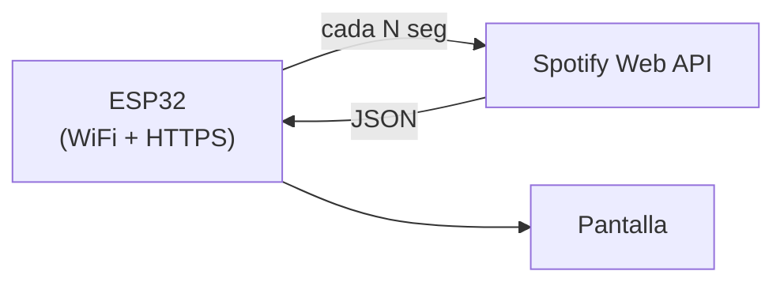
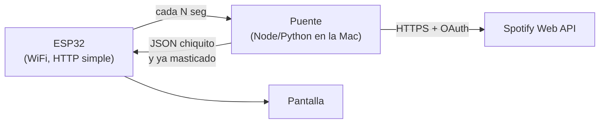

# ADR-0002 — Cómo obtiene el ESP32 lo que estás escuchando en Spotify

- **Estado:** `Propuesto` ⚠️ *(pendiente de decidir contigo — ver "Decisión")*
- **Fecha:** 2026-08-29
- **Reemplaza a:** —
- **Relacionado con:** RF-01, RF-02, ADR-0003 (letras)

---

## Contexto

El requerimiento inicial es que el ESP32 muestre la canción que estás escuchando
y el disco al que pertenece. Después, la letra.

Spotify expone una **Web API** con un endpoint que devuelve exactamente eso:
título, artista, álbum, portada y en qué segundo va la reproducción. El problema
no es *si existe el dato*, sino **quién va a ir a buscarlo**.

Hay dos arquitecturas posibles y son muy distintas en dificultad y en lo que se
aprende con cada una.

## Qué sabíamos y qué no

**Lo que sabíamos con certeza:**

- La Spotify Web API requiere autenticación **OAuth 2.0**. No basta con una API
  key: hay que hacer un flujo de autorización una vez, obtener un *refresh token*,
  y con él pedir *access tokens* que caducan (típicamente en 1 hora).
- Toda la API va por **HTTPS**. El ESP32 puede hacer HTTPS, pero el cifrado TLS
  consume bastante RAM, y el ESP32 tiene ~320 KB para todo.
- El ESP32 tiene WiFi integrado. No hace falta hardware extra para esto.

**Lo que asumimos sin verificar:**

- ⚠️ Que el endpoint de "reproduciendo ahora" sigue disponible para apps nuevas
  en 2026 y bajo qué condiciones. Spotify ha ido restringiendo su API con el
  tiempo y ha marcado endpoints como obsoletos. **Esto hay que verificarlo en la
  fase 5 antes de escribir una línea de código.**
- Que una app en "modo desarrollo" (uso personal, sin revisión de Spotify) basta
  para el caso de uso.
- Que la respuesta JSON de Spotify cabe en memoria del ESP32 si se parsea de
  forma incremental.

**Lo que quedó pendiente de averiguar:**

- El tamaño real de la respuesta JSON.
- Cuánta RAM libre queda en el ESP32 con TLS activo.
- Cada cuánto se puede consultar sin toparse con el límite de peticiones.

## Opciones consideradas

### Opción A — El ESP32 habla directo con Spotify

- **A favor:**
  - Es un aparato **autónomo de verdad**: lo enchufas donde sea y funciona. No
    necesita que tu Mac esté prendida.
  - Es el camino que más enseña: WiFi, HTTPS, certificados, OAuth, parseo de JSON
    en un dispositivo con memoria limitada. Todo eso es IoT real.
  - Es lo que quieres poder decir que construiste.
- **En contra:**
  - Bastante más difícil. TLS + JSON en 320 KB de RAM obliga a tener cuidado.
  - Hay que guardar el *refresh token* en el ESP32. Si el aparato se pierde, ese
    token da acceso a tu cuenta de Spotify hasta que lo revoques.
  - Los **certificados raíz caducan**. Un aparato que funcionaba deja de
    funcionar solo, un día, sin que hayas tocado nada.
  - Depurar es incómodo: el único diagnóstico es lo que imprimas por el puerto
    serie.
- **Costo:** alto en tiempo, alto en aprendizaje (que aquí es una ventaja).

### Opción B — Un puente en la Mac (o una Raspberry Pi)

Un programita en la Mac hace el trabajo pesado (OAuth, HTTPS, parseo) y le
entrega al ESP32 una respuesta mínima, ya recortada al tamaño de la pantalla.

- **A favor:**
  - El código del ESP32 se vuelve casi trivial: pedir por HTTP simple y dibujar.
  - Se pueden combinar varias fuentes (Spotify + letras) sin tocar el firmware.
  - Depurar es muchísimo más fácil: el puente corre en la Mac, con logs de verdad.
  - El *refresh token* nunca sale de tu computadora.
- **En contra:**
  - El aparato **deja de ser autónomo**. Si la Mac está apagada, el Tamagotchi
    muestra una pantalla vacía. Para un objeto que quieres tener en el escritorio,
    esto es una limitación real.
  - Se aprende menos de IoT: la parte interesante ocurre en la computadora.
- **Costo:** bajo en tiempo, bajo en aprendizaje.

### Opción C — Empezar con puente y migrar a directo después

Hacer primero la opción B para tener algo funcionando y ver píxeles en la
pantalla rápido, y una vez que la parte de pantalla y diseño esté resuelta,
mover la lógica al ESP32.

- **A favor:** separa dos problemas difíciles en vez de pelearlos juntos. Si algo
  no funciona, sabes de qué lado está.
- **En contra:** parte del trabajo se hace dos veces.

## Decisión

⚠️ **Pendiente.** Esta decisión te toca a ti porque depende de qué quieres
priorizar, y las dos respuestas son legítimas.

**Mi recomendación: opción C, empezar por el puente.**

El motivo: en este proyecto hay dos cosas difíciles a la vez — hacer que el ESP32
hable con internet de forma segura, y hacer que se vea bien en una pantalla
diminuta. Si las atacas juntas y no funciona, no vas a saber cuál de las dos
falló. Empezando por el puente resuelves primero la pantalla (que es la parte
visible y satisfactoria), y después migras la conexión al ESP32 con la pantalla ya
funcionando como herramienta de diagnóstico.

Y el destino sigue siendo la opción A: el aparato autónomo. Solo que llegando por
un camino donde cada paso se puede verificar.

**Si prefieres ir directo a la opción A, también está bien** — es más lento pero
aprendes más rápido, valga la contradicción. Dímelo y actualizo este ADR.

## Consecuencias

*(Se completa cuando se tome la decisión.)*

**Lo que hay que vigilar en cualquiera de los casos:**

- Que el endpoint de Spotify siga vivo y accesible en modo desarrollo. **Este es
  el riesgo número uno del proyecto**: si Spotify cierra ese acceso, no hay
  código que lo arregle. Verificar antes que nada.
- El límite de peticiones. Consultar cada 1 segundo casi seguro es demasiado;
  cada 5–10 segundos suele ser razonable.
- Que el *refresh token* no acabe subido a ningún repositorio público.

## Cómo revertir

**Medio.** Cambiar de puente a directo (o al revés) implica reescribir la capa de
red del firmware, pero **no** toca la capa de pantalla ni la lógica de
presentación. Si el código se estructura separando "de dónde vienen los datos" de
"cómo se dibujan", el cambio queda contenido en un solo archivo.

Esa separación es, de hecho, la razón principal por la que la opción C es viable.
