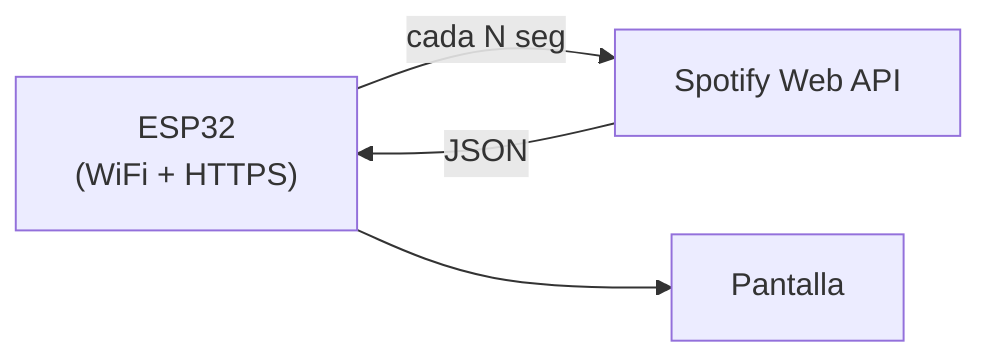
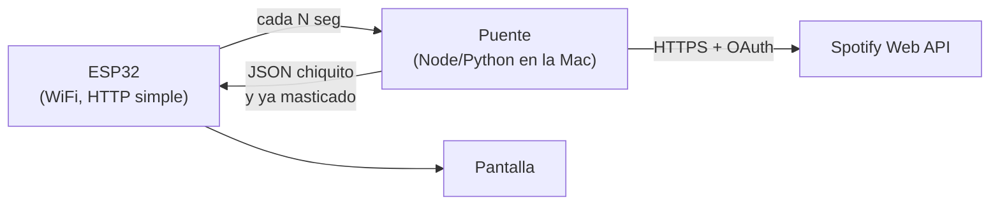
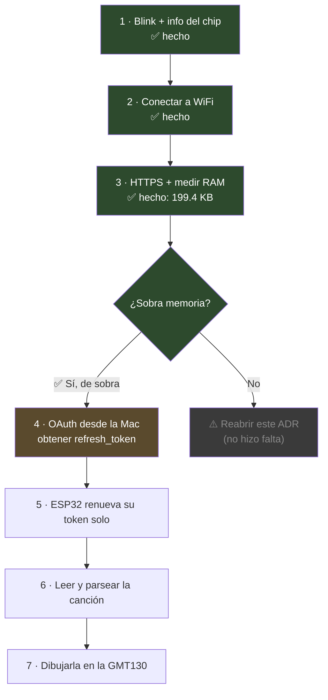

# ADR-0002 — Cómo obtiene el ESP32 lo que estás escuchando en Spotify

- **Estado:** `Aceptado` ✅ *(decidido el 2026-08-29)*
- **Fecha:** 2026-08-29
- **Reemplaza a:** —
- **Relacionado con:** RF-01, RF-02, ADR-0003 (letras), supuestos S-04 y S-09

---

## Contexto

El requerimiento inicial es que el ESP32 muestre la canción que estás escuchando
y el disco al que pertenece. Después, la letra.

Spotify expone una **Web API** con un endpoint que devuelve exactamente eso:
título, artista, álbum, portada y en qué segundo va la reproducción. El problema
no es *si existe el dato*, sino **quién va a ir a buscarlo**.

Hay dos arquitecturas posibles y son muy distintas en dificultad y en lo que se
aprende con cada una.

## Qué sabíamos y qué no

**Lo que sabíamos con certeza:**

- La Spotify Web API requiere autenticación **OAuth 2.0**. No basta con una API
  key: hay que hacer un flujo de autorización una vez, obtener un *refresh token*,
  y con él pedir *access tokens* que caducan (típicamente en 1 hora).
- Toda la API va por **HTTPS**. El ESP32 puede hacer HTTPS, pero el cifrado TLS
  consume bastante RAM, y el ESP32 tiene ~320 KB para todo.
- El ESP32 tiene WiFi integrado. No hace falta hardware extra para esto.

**Lo que asumimos sin verificar:**

- ✅ **Verificado el 2026-08-29** — el endpoint sigue activo y quedó fuera de los
  recortes de 2024 y 2026. Ver [investigación](../5-investigacion/spotify-api-2026.md).
- ✅ **Verificado** — el modo desarrollo permite 5 usuarios, de sobra. Exige que el
  dueño tenga **Spotify Premium**: confirmado, plan Familiar como titular.
- Que la respuesta JSON de Spotify cabe en memoria del ESP32 si se parsea de
  forma incremental.

**Lo que quedó pendiente de averiguar:**

- El tamaño real de la respuesta JSON.
- Cuánta RAM libre queda en el ESP32 con TLS activo.
- Cada cuánto se puede consultar sin toparse con el límite de peticiones.

## Opciones consideradas

### Opción A — El ESP32 habla directo con Spotify

- **A favor:**
  - Es un aparato **autónomo de verdad**: lo enchufas donde sea y funciona. No
    necesita que tu Mac esté prendida.
  - Es el camino que más enseña: WiFi, HTTPS, certificados, OAuth, parseo de JSON
    en un dispositivo con memoria limitada. Todo eso es IoT real.
  - Es lo que quieres poder decir que construiste.
- **En contra:**
  - Bastante más difícil. TLS + JSON en 320 KB de RAM obliga a tener cuidado.
  - Hay que guardar el *refresh token* en el ESP32. Si el aparato se pierde, ese
    token da acceso a tu cuenta de Spotify hasta que lo revoques.
  - Los **certificados raíz caducan**. Un aparato que funcionaba deja de
    funcionar solo, un día, sin que hayas tocado nada.
  - Depurar es incómodo: el único diagnóstico es lo que imprimas por el puerto
    serie.
- **Costo:** alto en tiempo, alto en aprendizaje (que aquí es una ventaja).

### Opción B — Un puente en la Mac (o una Raspberry Pi)

Un programita en la Mac hace el trabajo pesado (OAuth, HTTPS, parseo) y le
entrega al ESP32 una respuesta mínima, ya recortada al tamaño de la pantalla.

- **A favor:**
  - El código del ESP32 se vuelve casi trivial: pedir por HTTP simple y dibujar.
  - Se pueden combinar varias fuentes (Spotify + letras) sin tocar el firmware.
  - Depurar es muchísimo más fácil: el puente corre en la Mac, con logs de verdad.
  - El *refresh token* nunca sale de tu computadora.
- **En contra:**
  - El aparato **deja de ser autónomo**. Si la Mac está apagada, el Tamagotchi
    muestra una pantalla vacía. Para un objeto que quieres tener en el escritorio,
    esto es una limitación real.
  - Se aprende menos de IoT: la parte interesante ocurre en la computadora.
- **Costo:** bajo en tiempo, bajo en aprendizaje.

### Opción C — Empezar con puente y migrar a directo después

Hacer primero la opción B para tener algo funcionando y ver píxeles en la
pantalla rápido, y una vez que la parte de pantalla y diseño esté resuelta,
mover la lógica al ESP32.

- **A favor:** separa dos problemas difíciles en vez de pelearlos juntos. Si algo
  no funciona, sabes de qué lado está.
- **En contra:** parte del trabajo se hace dos veces.

## Decisión

**Opción A: el ESP32 habla directo con Spotify.** Sin puente, sin intermediarios.

Yo había recomendado la opción C (empezar por el puente para separar los dos
problemas difíciles). **Se descartó a favor de la A, y con buen motivo.**

El factor que decidió: el
[requerimiento raíz del proyecto](../4-requerimientos/REQUERIMIENTOS.md#para-qué-lo-quiero)
es **aprender electrónica e IoT**. Con ese objetivo, la parte que yo proponía
mover a la Mac —WiFi, TLS, OAuth, parsear JSON con memoria contada— **es
justamente lo que hay que aprender**. Sacarla del ESP32 habría sacado del proyecto
lo más valioso que tiene para enseñar.

Mi argumento a favor del puente era de eficiencia (llegar antes a ver píxeles).
Ese argumento pierde fuerza cuando el objetivo no es llegar, sino recorrer.

Y hay un segundo motivo, más práctico: el destino siempre fue la opción A. El
puente habría significado escribir dos veces la capa de red. La ruta directa
cuesta más al principio y menos en total.

## Cómo se compensa la dificultad

Se elige el camino difícil, pero **no se ataca de golpe**. El orden importa, y
cada paso se verifica antes de pasar al siguiente:

**El paso 3 es el punto de control.** Ahí se mide cuánta RAM queda con TLS activo
(supuesto S-04).

> ## ✅ Punto de control superado — 2026-08-29
>
> Mínimo histórico de RAM libre con TLS activo contra el servidor real de
> Spotify: **199.4 KB**. El umbral de "sobra" eran 100 KB.
>
> Además: **sin fugas de memoria** (se recupera íntegra al cerrar) y **sin
> fragmentación** (el bloque contiguo mayor no se movió). Medición completa en
> [`5-investigacion/spike-memoria-tls.md`](../5-investigacion/spike-memoria-tls.md).
>
> **Esta decisión queda confirmada. No hay que reabrirla.**

El camino de salida se dibujó de todos modos, y esa es la parte que importa de
este ADR: **la decisión llevaba escrita su propia condición de reversa** antes de
saber el resultado. Si el número hubiera salido mal, no habría hecho falta
discutir nada — ya estaba acordado qué hacer.

## Consecuencias

**Lo que esto nos habilita:**

- El aparato es **autónomo de verdad**. Se enchufa donde sea y funciona, sin
  depender de que la Mac esté prendida.
- Se aprende lo que se venía a aprender: WiFi, HTTPS, certificados, OAuth y
  gestión de memoria en un dispositivo con 320 KB.
- Nada que mantener corriendo en la Mac.

**Lo que esto nos cuesta:**

- Bastante más difícil. El paso 3 puede tumbar el plan.
- Depurar es incómodo: el único diagnóstico es lo que se imprima por el puerto
  serie. (Por eso el `platformio.ini` ya trae `esp32_exception_decoder`, que
  traduce los crashes de direcciones de memoria a nombres de función.)
- El `refresh_token` vive en el ESP32. Si el aparato se pierde o se presta, hay
  que revocarlo desde la cuenta de Spotify.

**Lo que hay que vigilar:**

- ✅ ~~La RAM libre~~ — medida el 2026-08-29: 199.4 KB de margen. Por eso el
  firmware de prueba ya lo imprime desde el primer día.
- 🔐 **Que el `refresh_token` no acabe en Git.** El `.gitignore` ya bloquea
  `secrets.h` y `credentials.h` (RNF-05).
- 📜 **Los certificados raíz caducan.** Es el único riesgo del proyecto donde el
  aparato funciona meses y **deja de funcionar solo, un día, sin que nadie haya
  tocado nada**. Cuando llegue el paso 3 hay que decidir cómo manejarlo y
  anotar la fecha de caducidad en algún lado.
- ⏱️ **El límite de peticiones.** Consultar cada ~5 s y **respetar siempre el
  `Retry-After`** de las respuestas 429.

## Cómo revertir

**Medio.** Migrar a la arquitectura de puente implicaría reescribir la capa de red
del firmware, pero **no** tocaría la capa de pantalla ni la lógica de
presentación.

Por eso el código debe estructurarse desde el principio separando **"de dónde
vienen los datos"** de **"cómo se dibujan"**. Es una regla que ya salió por tres
motivos distintos —este ADR, el [0003](ADR-0003-fuente-de-las-letras.md) (cambiar
de fuente de letras) y el [0004](ADR-0004-pantalla-gmt130.md) (cambiar de
pantalla)—, y cuando tres razones independientes apuntan a la misma estructura,
esa estructura es la correcta.

Esa separación es también lo que hace barata la salida del paso 3: si la memoria
no alcanza, se cambia el origen de los datos sin tocar nada más.
