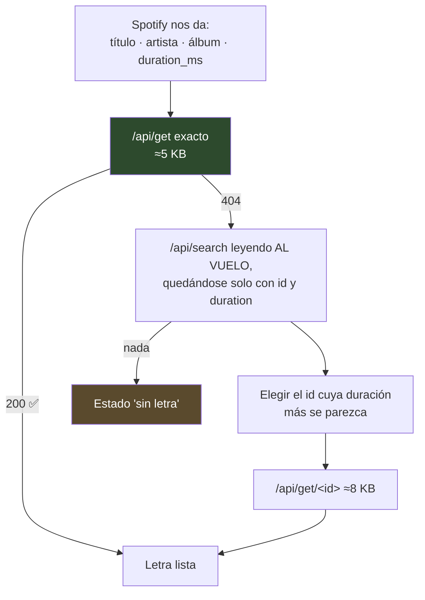

# ADR-0003 — De dónde salen las letras de las canciones

- **Estado:** `Aceptado` ✅ *(decidido el 2026-08-29, tras verificar la API)*
- **Fecha:** 2026-08-29
- **Reemplaza a:** —
- **Relacionado con:** RF-04, ADR-0002, supuesto S-05

---

## Contexto

El requerimiento a futuro es mostrar la letra de la canción que está sonando.

Aquí hay una sorpresa que conviene saber desde ahora, porque cambia el plan:

> **La API pública de Spotify no da letras.**

Las letras que ves en la app de Spotify vienen de un proveedor externo
(Musixmatch), a través de un endpoint interno que no forma parte de la API
pública ni está permitido usar desde fuera de la app.

O sea: aunque el ESP32 logre hablar con Spotify perfectamente, **de ahí no van a
salir las letras**. Hace falta una segunda fuente, distinta, y hay que cruzar la
canción de Spotify con la letra de esa otra fuente.

Este ADR existe para que esa sorpresa esté documentada desde el día uno y no te
la encuentres a mitad del proyecto.

## Qué sabíamos y qué no

**Lo que sabíamos con certeza:**

- La Web API pública de Spotify no expone letras.
- Las letras vienen en dos sabores muy distintos:
  - **Letra plana** — el texto completo, sin marcas de tiempo.
  - **Letra sincronizada** (formato `.lrc`) — cada línea lleva su marca de
    tiempo: `[01:23.45] línea de la canción`. Esto es lo que permite que la
    pantalla vaya cambiando de línea al ritmo de la canción.
- Spotify **sí** devuelve el `progress_ms` (en qué milisegundo va la
  reproducción). Ese dato es justamente lo que hace falta para sincronizar una
  letra `.lrc`. Así que la mitad del rompecabezas ya la tenemos.

**Verificado el 2026-08-29** (ver [investigación](../5-investigacion/lrclib-api.md)):

- ✅ **LRCLIB está en línea, es gratis y NO pide autenticación.** Petición pelada,
  sin ninguna clave → HTTP 200. Cero OAuth que implementar.
- ✅ **Cobertura suficiente.** De las canciones probadas por el usuario, casi
  todas están. La única que parecía faltar (`If` de Red Hot Chili Peppers) sí
  estaba, con 8 versiones y letra sincronizada.
- ✅ **El cruce funciona, y la clave es la duración.** El 404 inicial lo causó una
  duración equivocada, no el nombre del álbum. Y la duración es justo lo que
  Spotify da con precisión en `duration_ms`.
- ⚠️ **Una letra completa sí cabe** (~5 KB por canción), **pero la búsqueda amplia
  no**: `/api/search` devuelve 91–115 KB porque incluye la letra completa de 20
  resultados. Eso es más de la mitad de la memoria libre del ESP32.

**Lo que quedó pendiente de averiguar:**

- Si la sincronización se siente bien en la práctica o se desfasa.
- Cuántos caracteres caben realmente en la pantalla que acabemos usando. **Este
  es un problema mayor de lo que parece** — ver "Lo que hay que vigilar".

## Opciones consideradas

### Opción A — LRCLIB (`lrclib.net`)

- **A favor:** gratis, abierto, **sin autenticación** (no hay OAuth que
  implementar, que es justo la parte más pesada para un ESP32). Devuelve letra
  plana **y** sincronizada. Se busca por artista + título + álbum + duración, que
  es exactamente lo que Spotify entrega.
- **En contra:** cobertura desigual, es un proyecto comunitario. Depende de que
  el servicio siga en pie.
- **Costo:** bajo.

### Opción B — API oficial de Musixmatch

- **A favor:** es la fuente que usa Spotify. Cobertura enorme y de calidad.
- **En contra:** requiere API key. Su plan gratuito históricamente devuelve solo
  un **fragmento** de la letra (no la completa), y la letra sincronizada es de
  pago. Para el caso de uso, un fragmento no sirve.
- **Costo:** medio o alto, según el plan.

### Opción C — Genius

- **A favor:** cobertura excelente, sobre todo en hip-hop, y anotaciones.
- **En contra:** su API oficial **no devuelve el texto de la letra** — solo
  metadatos y la URL de la página. Obtener el texto implicaría hacer scraping de
  la página web, lo que va contra sus términos de servicio. Y no tiene marcas de
  tiempo, así que no se puede sincronizar.
- **Costo:** descartada por los términos de servicio.

### Opción D — Letras precargadas a mano

Guardar en el ESP32 las letras de un puñado de canciones favoritas.

- **A favor:** cero dependencias externas. Funciona siempre.
- **En contra:** no escala más allá de unas pocas canciones. Pero **es una
  excelente opción para la primera prueba**: permite resolver el problema difícil
  (cómo se ve una letra en una pantalla chiquita y cómo se sincroniza) sin
  depender de que ninguna API funcione.
- **Costo:** muy bajo.

## Decisión

**LRCLIB (opción A), con una estrategia de dos pasos.**

Se descarta la idea previa de empezar con letras precargadas a mano (opción D).
Tenía sentido cuando no sabíamos si la API servía; ahora que está verificada, ese
rodeo solo duplicaría trabajo.

### Cómo se busca

**El camino normal es el primero**, y cuesta 5 KB. Funciona porque Spotify nos da
la duración exacta. El rodeo solo hace falta con versiones cuya duración no
cuadre: remasterizaciones, ediciones deluxe, grabaciones en vivo.

### Por qué el rodeo no revienta la memoria

`/api/search` devuelve 91 KB porque incluye la letra completa de 20 resultados.
Cargarlo entero sería temerario. En su lugar se lee **al vuelo**, con un filtro
de ArduinoJson que descarta las letras y conserva solo `id` y `duration` — unos
cientos de bytes. Con el `id` elegido se pide la canción concreta, que sí cabe.

Es exactamente la misma técnica que ya se usa con el JSON de Spotify, y la
tercera vez que el filtro de ArduinoJson salva el proyecto.

### "Sin letra" es un estado normal, no un error

LRCLIB es comunitaria y **habrá huecos**. También hay canciones marcadas como
`instrumental`, que no tienen letra por naturaleza.

En ambos casos el aparato debe **seguir mostrando canción, artista y progreso**,
e indicar en el hueco de la letra que no hay. Nunca dejar la pantalla en blanco
ni congelada.

Distinguir los tres casos importa:

| Situación | Qué mostrar |
|---|---|
| Hay letra | La letra, sincronizada |
| `instrumental: true` | "instrumental" — no es un fallo |
| No se encontró | "sin letra" — puede que alguien la aporte algún día |

## Consecuencias

**Lo que esto nos habilita:**

- Se puede avanzar en la parte de letras **sin haber resuelto la API**, lo que
  desbloquea trabajo en paralelo.

**Lo que hay que vigilar:**

- ✅ **Actualización 2026-08-29 — el cuello de botella se alivió.** Este ADR se
  escribió asumiendo una OLED de 0.96" (128×64), donde caben ~4 líneas de ~20
  caracteres y un verso normal no entra. Al levantar el inventario aparecieron 4
  pantallas **GMT130 de 240×240 a color** ([ADR-0004](ADR-0004-pantalla-gmt130.md)):
  del orden de 15 líneas de ~30 caracteres. El RF-04 pasa de "probablemente
  inviable" a "hay que probarlo", y por eso subió de prioridad `Podría` a
  `Debería`.
  ⚠️ Queda un riesgo distinto: 240 píxeles en 1.3 pulgadas son píxeles diminutos.
  El texto puede verse nítido y aun así **no leerse** a 60 cm (RNF-01). Eso se
  mide con la pantalla enfrente, no en el papel.
- La cobertura de LRCLIB para tu música en concreto. Vale la pena probar a mano,
  desde el navegador, con 5 canciones que sí escuches, antes de programar nada.
- Que el desfase de sincronización se mantenga tolerable. El `progress_ms` de
  Spotify llega con retraso de red, así que va a haber algo de desfase siempre.

## Cómo revertir

**Barato**, si el código se estructura bien. Si la parte que dibuja la letra
recibe una lista de líneas con sus tiempos, sin saber de dónde salió, cambiar de
fuente es cambiar una función.

Es la misma separación *"de dónde vienen los datos"* contra *"cómo se dibujan"*
que ya pedían los ADRs [0002](ADR-0002-como-obtener-datos-de-spotify.md),
[0004](ADR-0004-pantalla-gmt130.md) y [0008](ADR-0008-libreria-de-pantalla.md).
Cinco razones independientes apuntando a la misma estructura.
