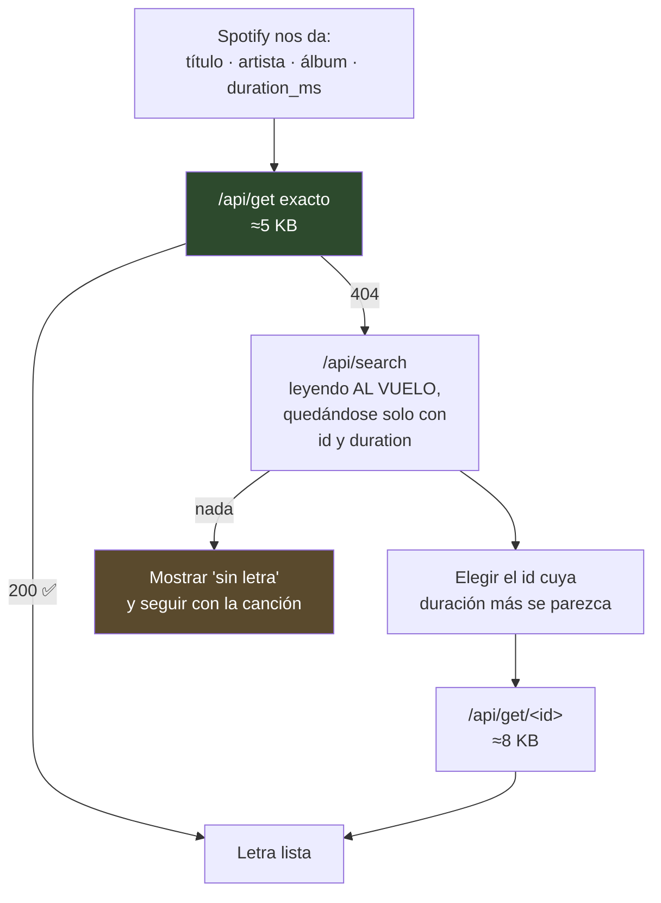

# Investigación — LRCLIB como fuente de letras

- **Fecha:** 2026-08-29
- **Resuelve:** supuesto [S-05](../4-requerimientos/REQUERIMIENTOS.md#supuestos) — el último que quedaba abierto
- **Método:** consultas reales a la API, no documentación
- **Confianza:** máxima (medido)

---

## Qué es LRCLIB

Una **base de datos comunitaria de letras de canciones**, gratuita y abierta.
Cualquiera puede consultarla, y cualquiera puede aportar letras que falten.

Existe porque **ningún servicio de música da acceso a sus letras**. Spotify las
muestra en su app, pero vienen de un proveedor externo (Musixmatch) por un canal
interno que no se puede usar desde fuera — ver
[`spotify-api-2026.md`](spotify-api-2026.md). Así que si quieres letras en tu
propio aparato, tienen que salir de otro lado. LRCLIB es ese otro lado.

**Lo que la hace ideal para un ESP32:**

| | |
|---|---|
| 🔓 **Sin autenticación** | Verificado: petición pelada, sin ninguna clave → HTTP 200. Cero OAuth que implementar, que es la parte más pesada |
| 💰 Gratis | Sin cuotas ni registro |
| ⏱️ **Letras sincronizadas** | Con marca de tiempo por línea. Es lo que permite que la pantalla avance al ritmo de la canción |
| 🔍 Busca por lo que Spotify ya nos da | Título + artista + álbum + duración |

## Cómo se ve una letra sincronizada

El formato se llama **LRC**, y es texto plano:

```
[00:20.56] Psychic spies from China try to steal your mind's elation
[00:25.56] And little girls from Sweden dream of silver-screen quotation
[00:30.69] And if you want these kind of dreams
[00:33.02] It's Californication
```

Cada línea trae **minuto:segundo.centésima**. Spotify nos dice en qué milisegundo
va la reproducción (`progress_ms`), así que el ESP32 solo tiene que buscar la
última línea cuyo tiempo ya pasó. Eso es todo el RF-04.

## Qué devuelve la API

```
id · name · trackName · artistName · albumName · duration
instrumental · plainLyrics · syncedLyrics
```

Ese `instrumental` es útil: marca las canciones **sin letra por naturaleza**.
Distinguirlas de "no encontré la letra" evita mostrar un error donde no lo hay.

---

## 🔑 El hallazgo importante: la duración manda

Al probar `If` de Red Hot Chili Peppers, la búsqueda exacta devolvió **404** —
parecía que la canción no estaba. Pero la búsqueda amplia devolvió **8 versiones,
todas con letra sincronizada**.

| Consulta | Resultado |
|---|---|
| `/api/get` con `album=Stadium Arcadium`, `duration=143` | ❌ **404** |
| `/api/get` con `album=Stadium Arcadium`, `duration=`**`173`** | ✅ **200** |

**La canción siempre estuvo ahí. El 404 lo causó una duración equivocada** — 143
segundos inventados contra los 173 reales.

Y esto es una **buena noticia para el proyecto**: la duración es justamente el
dato que Spotify sí nos da con precisión, en `duration_ms`. No hay que adivinarla.

Nótese también que el nombre del álbum resultó **tolerante**: funcionó con
`"Stadium Arcadium"` a secas, aunque en LRCLIB los registros se llaman
`"Stadium Arcadium: Mars [Disc 02]"`, `"Stadium Arcadium(2)"`, etc.

> 💡 **Por qué probablemente no la encontraste en la web:** la búsqueda del sitio
> y la de la API no se comportan igual. Programáticamente, con la duración
> correcta, aparece sin problema.

---

## ⚠️ El problema real: el tamaño de las respuestas

Medido contra los ~198 KB libres del ESP32:

| Consulta | Tamaño | ¿Cabe? |
|---|---|---|
| `/api/get` (una canción, exacta) | **5.3 KB** | ✅ Perfecto |
| `/api/get/<id>` (una canción, por id) | **8.6 KB** | ✅ Bien |
| `/api/search?track_name=&artist_name=` | **91 KB** | ⚠️ Arriesgado |
| `/api/search?q=...` (búsqueda libre) | **115 KB** | 🚫 No |

`/api/search` devuelve **20 resultados con la letra completa de cada uno**. Es
comodísimo desde una computadora y un problema serio en un microcontrolador: 115
KB serían más de la mitad de la memoria libre, y eso antes de contar lo que TLS
ya está usando.

## La estrategia que sale de todo esto



**El camino normal es el primero** y cuesta 5 KB, porque Spotify nos da la
duración exacta. El rodeo solo hace falta cuando la duración no cuadra (versiones
remasterizadas, ediciones deluxe, en vivo).

Y el rodeo esquiva el problema de los 91 KB: se lee la respuesta **al vuelo** con
un filtro de ArduinoJson que descarta las letras y conserva solo `id` y
`duration` de cada resultado. Unos cientos de bytes en vez de 91 KB. Es la misma
técnica que ya se usa con el JSON de Spotify.

## Conclusión sobre el supuesto S-05

✅ **Resuelto: hay cobertura suficiente.**

De las canciones que probó el usuario, **casi todas están**. La única que parecía
faltar sí estaba — el fallo era de la consulta, no de la base de datos.

⚠️ Pero **habrá huecos**, es una base comunitaria. Por eso "no hay letra" tiene
que ser un **estado normal de la pantalla**, no un error: se sigue mostrando la
canción, el artista y el progreso, y donde iría la letra se indica que no hay.

Nunca se debe dejar la pantalla en blanco ni congelada por esto.

> 💡 A LRCLIB **se le pueden aportar letras** que falten. Si alguna canción que
> escuchas mucho no está, se puede subir — y de paso queda para todos.
