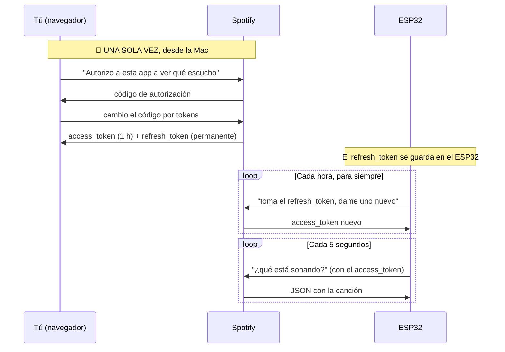

# Investigación — Estado de la API de Spotify (agosto 2026)

- **Fecha:** 2026-08-29
- **Resuelve:** supuesto [S-02](../4-requerimientos/REQUERIMIENTOS.md#supuestos) — *el riesgo #1 del proyecto*
- **Método:** documentación oficial de Spotify for Developers
- **Confianza:** alta (fuentes primarias), salvo donde se indique

---

## Veredicto

> ## ✅ El proyecto es viable
> **con una condición: el dueño de la app debe tener Spotify Premium.**

El endpoint que necesitamos sigue vivo y **no** fue tocado por los recortes de
2024 ni por los de febrero de 2026.

---

## 1. ¿Sigue existiendo el endpoint? — Sí

`GET /me/player/currently-playing` está activo y documentado.

| Dato que devuelve | Campo | Para qué lo queremos |
|---|---|---|
| Título de la canción | `item.name` | **RF-01** |
| Álbum | `item.album.name` | **RF-02** |
| Artistas | `item.artists[]` | **RF-03** |
| Duración total | `item.duration_ms` | Cruzar con la fuente de letras |
| **Milisegundo actual** | **`progress_ms`** | **RF-04** — sincronizar la letra |

Ese `progress_ms` es la pieza clave: es lo que permitirá que la letra avance al
ritmo de la canción. Sin él, el RF-04 sería imposible.

**Permiso (*scope*) necesario:** `user-read-currently-playing` — uno solo, el
mínimo posible. Bien: pedir solo lo indispensable es buena práctica, y si algún
día el token se filtra, el daño se limita a que alguien vea qué escuchas.

## 2. ¿Los recortes de 2024 nos afectan? — No

El 27 de noviembre de 2024 Spotify cerró varios endpoints para apps nuevas:
recomendaciones, artistas relacionados, *audio features*, análisis de audio,
playlists destacadas. Fue un golpe fuerte para muchos proyectos.

**Ninguno de esos es el nuestro.** Los endpoints de reproductor quedaron intactos.

## 3. ⚠️ Los cambios de febrero de 2026 — tampoco, pero traen una condición

En febrero de 2026 Spotify restringió el Modo Desarrollo. Las restricciones caen
sobre **gestión de biblioteca, playlists, búsquedas por lote, y endpoints de
navegación/artistas**.

**Los endpoints de reproductor no están en esa lista.** Seguimos bien.

Pero de ahí sale el requisito nuevo:

> ### 🔴 "El dueño de la app debe tener una cuenta Spotify Premium para que las apps en modo desarrollo funcionen."
> — Documentación oficial, *Quota modes*

**Esto es un prerequisito duro, no un "sería bueno".** Sin Premium, la app no
funciona y no hay forma de programarla alrededor.

## 4. ¿Qué es el "Modo Desarrollo" y nos alcanza? — Sí, de sobra

Toda app nueva de Spotify nace en Modo Desarrollo:

| | Modo Desarrollo | Modo Cuota Extendida |
|---|---|---|
| Usuarios | **5** | Ilimitados |
| Lista de permitidos | Sí — los agregas a mano | No |
| Límite de peticiones | Bajo | Alto |
| Quién puede pedirlo | Cualquiera | **Solo organizaciones** |

**Para tu caso, 5 usuarios sobran** — solo te necesitas a ti.

Y hay que asumir que **el Modo Desarrollo es el hogar permanente de este
proyecto**, porque el Modo Extendido está fuera de alcance para siempre:

Desde el 15 de mayo de 2025, Spotify solo acepta solicitudes de **organizaciones,
no de individuos**, y exige entre otras cosas una empresa legalmente registrada,
un servicio ya lanzado y **mínimo 250.000 usuarios activos mensuales**.

No es un problema para el Tamagotchi. Pero conviene saber que **este proyecto
nunca podrá compartirse públicamente** como producto. Es de uso personal por
diseño, no por decisión nuestra.

📌 *Actualización de julio de 2026:* ahora se pueden tener hasta 25 Client IDs por
cuenta de desarrollador, pero **la cuota se comparte entre todos**. Si algún día
haces otro proyecto con Spotify, ambos consumen del mismo presupuesto.

## 5. Límite de peticiones — cada cuánto puede preguntar el ESP32

- Se calcula sobre una **ventana móvil de 30 segundos**.
- **Spotify no publica el número exacto** para Modo Desarrollo. Solo dice que es
  "bajo".
- Al pasarse: **HTTP 429**, con una cabecera `Retry-After` que dice cuántos
  segundos esperar.

**Qué significa para el diseño:** al no haber número publicado, hay que ser
conservador y **respetar siempre el `Retry-After`**.

Con una consulta cada 5 segundos son 6 peticiones por ventana de 30 s — muy
probablemente seguro, y da un retraso máximo de 5 s al cambiar de canción, dentro
del criterio del RF-01 (< 10 s).

💡 **Optimización para más adelante:** cuando ya sepamos la duración de la canción
y en qué milisegundo va, el ESP32 puede *calcular* cuándo va a terminar y
preguntar justo entonces, en vez de cada 5 segundos a ciegas. Menos peticiones y
más reactivo. Es exactamente para lo que sirve el `duration_ms`.

## 6. Autenticación — el paso que hay que hacer una sola vez

Spotify usa **OAuth 2.0**, que no es una API key sino un baile de tres pasos:

**La idea clave:** el baile completo se hace **una sola vez** desde la Mac, con
tu navegador. De ahí sale un `refresh_token` que **no caduca**. Ese se guarda en
el ESP32, y con él la placa se renueva sola para siempre.

⚠️ **El `refresh_token` es tan valioso como una contraseña.** Nunca va en Git.
Por eso el `.gitignore` ya bloquea `secrets.h` y `credentials.h`, y por eso
existe el RNF-05.

---

## Qué se resuelve y qué se abre

| Supuesto | Antes | Ahora |
|---|---|---|
| S-02 — ¿la API sigue dando "reproduciendo ahora"? | ❌ Sin verificar (riesgo #1) | ✅ **Sí** |
| S-09 — ¿tienes Spotify Premium? | *(nuevo)* | ❓ **Por confirmar — bloqueante** |

**El riesgo #1 del proyecto queda cerrado.** Ya no existe el escenario "todo
funciona pero Spotify cerró la puerta".

En su lugar queda una pregunta de sí o no que se responde en 5 segundos.

## Siguiente paso concreto

1. **Confirmar que tienes Spotify Premium.**
2. Crear una app en <https://developer.spotify.com/dashboard> → salen el
   `Client ID` y el `Client Secret`.
3. Agregarte a ti mismo en la lista de usuarios permitidos de la app.
4. Hacer el baile de OAuth una vez, desde la Mac, para obtener el
   `refresh_token`.

> Para el paso 4 conviene un script local que abra tu navegador y capture la
> respuesta. **Tú inicias sesión en la página de Spotify** — así tus credenciales
> nunca pasan por ningún otro lado.

---

## Fuentes

- [Get Currently Playing Track](https://developer.spotify.com/documentation/web-api/reference/get-the-users-currently-playing-track)
- [Quota modes](https://developer.spotify.com/documentation/web-api/concepts/quota-modes)
- [February 2026 Web API Dev Mode Changes — Migration Guide](https://developer.spotify.com/documentation/web-api/tutorials/february-2026-migration-guide)
- [Web API quota updates for Development Mode (jul 2026)](https://developer.spotify.com/blog/2026-07-23-web-api-quota-updates)
- [Updating the Criteria for Web API Extended Access (abr 2025)](https://developer.spotify.com/blog/2025-04-15-updating-the-criteria-for-web-api-extended-access)
- [Introducing some changes to our Web API (nov 2024)](https://developer.spotify.com/blog/2024-11-27-changes-to-the-web-api)
- [Rate Limits](https://developer.spotify.com/documentation/web-api/concepts/rate-limits)
