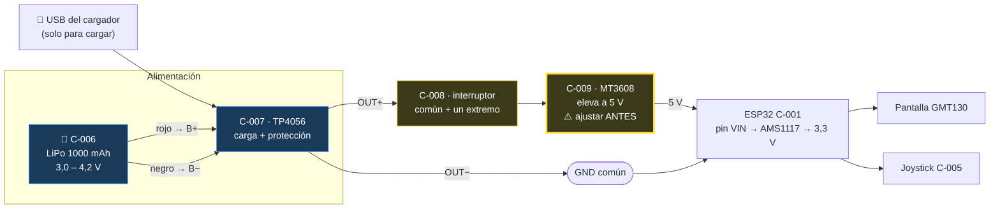

# Alimentación por batería

- **Estado:** 🟢 **Diseño cerrado — falta comprar el elevador C-009** (2026-08-30)
- **Decisión:** [ADR-0014](../1-decisiones/ADR-0014-alimentacion-por-bateria.md)
- **Piezas:** [C-006 batería](../3-componentes/bateria-lipo-1000mah.md) ·
  [C-007 cargador](../3-componentes/tp4056-cargador.md) ·
  [C-008 interruptor](../3-componentes/interruptor-ss12d00.md)

---

## Lo que se quiere

Que el Tamagotchi funcione **sin cable**, se cargue por USB, y se apague y
encienda con un interruptor. Hoy vive enchufado al USB del ESP32.

## ⚠️ Por qué no se puede conectar directamente

Es lo primero que hay que entender, porque la conexión "obvia" **no funciona y
puede romper la placa**.

La batería no da una tensión: da un **rango que se mueve mientras se gasta**.

```
        4,2 V ┤ recién cargada
              │
        3,7 V ┤ la mayor parte de su vida
              │
        3,3 V ┤ ......... lo que el ESP32 necesita .........
              │
        3,0 V ┤ vacía
```

Fíjate dónde cae la línea de 3,3 V: **en medio**. La batería empieza por encima y
termina por debajo. Los dos caminos directos fallan, cada uno a su manera:

| Conexión | Qué pasa | Gravedad |
|---|---|---|
| `OUT+` → pin **`3V3`** | 4,2 V en un pin que aguanta **3,6 V máximo** | 💀 **Rompe el ESP32** |
| `OUT+` → pin **`VIN`** | El regulador de la placa necesita más tensión de la que hay | ⚠️ Arranca y se reinicia solo |

El segundo merece explicación porque es el que engaña. El pin `VIN` no alimenta
al chip: entra a un **regulador** de la placa que baja a 3,3 V. Y un regulador
necesita un margen por encima de lo que entrega —lo que "se queda" para
funcionar—. Si el habitual `AMS1117` está montado, ese margen es de **1,1 V**:
necesitaría 4,4 V de entrada y la batería nunca los tiene.

Síntoma: funciona un rato con la batería llena, y al bajar a 3,7 V el aparato
**se reinicia solo**. Que es exactamente el fallo que ya está avisado en
`CLAUDE.md` — *"si la fuente no lo aguanta, la placa se reinicia sola y parece un
bug de software"*.

🔑 **Un regulador no puede subir tensión, solo bajarla — y ni siquiera hasta el
borde.** Siempre se queda con un peaje.

## ✅ El dato que faltaba, resuelto

Se leyó el chip de la placa C-001 el 2026-08-30: pone **`1117 3.3 BWQ53`**, o sea
un **`AMS1117-3.3`** — el de peaje alto, 1,1 V. Necesita **4,4 V** a la entrada y
la batería llega a 4,2 V como mucho.

> **No alcanza ni recién cargada.** Hace falta elevar.

⚠️ Al lado hay **dos transistores `J3Y` (S8050)**, que son el circuito de
auto-reset y no tienen que ver con la alimentación. Se confundieron dos veces
antes de dar con el bueno: el regulador es el que lleva **chapa metálica ancha**
detrás; los `J3Y` son diminutos y van en pareja.

Elegido el camino de elevar a 5 V y entrar por `VIN`
([ADR-0014](../1-decisiones/ADR-0014-alimentacion-por-bateria.md)): la batería
usa **el mismo camino que el USB**, que lleva meses funcionando, y no se estrena
ningún camino nuevo hacia el chip.

## El esquema

La pieza en amarillo es la única que falta por comprar (C-009).



### El interruptor: dónde va y por qué ahí

Va en la línea **`OUT+`**, entre el cargador y el resto. **No** entre la batería
y el cargador.

La razón es práctica: así **apagar el aparato no impide cargarlo**. Si el
interruptor cortara antes del cargador, tendrías que dejarlo encendido para que
cargase.

```
  TP4056 OUT+ ──── pata del MEDIO (común, ya tiene el cable rojo)
                        │
                   [interruptor]
                        │
                   pata de un EXTREMO ──── hacia el convertidor
                        
                   la otra pata del extremo: al aire, no se usa
```

⚠️ **Cuál de los dos extremos elijas decide hacia qué lado enciende.** Si al
montarlo queda al revés, se pasa el cable a la otra pata — no hay que rehacer
nada más.

⚠️ **La corriente va justa:** estos interruptores son de ~0,5 A y el ESP32 pica a
500 mA. Si el convertidor que se compre tiene pin **`EN`**, es mejor que el
interruptor gobierne ese pin en vez de llevar la corriente. Está explicado en
[su ficha](../3-componentes/interruptor-ss12d00.md).

## Orden de montaje

⚠️ **Un paso a la vez, y midiendo entre paso y paso.** Aquí hay una batería que
no se puede apagar: montarlo todo y probar deja varios sospechosos y una LiPo
suelta.

1. **Antes de tocar nada:** desconecta el USB del ESP32.
2. Suelda el segundo cable del interruptor a **una pata de un extremo**.
3. **Mide con el polímetro** entre los dos cables del interruptor: debe haber
   continuidad en una posición y ninguna en la otra. *Todavía sin batería.*
4. Suelda `OUT+` del cargador al cable de la **pata del medio**.
5. **Mide `OUT+` contra `OUT-`** con el interruptor encendido: debe salir la
   tensión de la batería (entre 3,0 y 4,2 V). ⚠️ **Con el interruptor apagado
   debe dar 0 V.** Si no da 0, algo está mal cableado: para y revisa.
6. **Ajustar el MT3608 a 5 V.** ⚠️ **Este es el paso que puede matar la placa.**
   Se alimenta el elevador desde la batería, **con la salida al aire**, y se gira
   el tornillito midiendo `OUT+` contra `OUT-` hasta leer **5,0 V**. Puede venir
   ajustado a 20 V de fábrica: con eso conectado, el ESP32 no sobrevive.
7. Comprobar que sigue en 5 V al mover el interruptor. Solo entonces, conectar
   `5 V` al pin **`VIN`** y la masa a **`GND`**. ⚠️ **Nunca a `3V3`.**

⚠️ **En ningún momento juntes el cable de `OUT+` con el de `OUT-`.** Es un
cortocircuito de la batería.

## Lo que queda

- ✅ ~~Leer el regulador de la placa~~ → `AMS1117-3.3`, confirmado.
- ✅ ~~Elegir el camino~~ → elevar a 5 V ([ADR-0014](../1-decisiones/ADR-0014-alimentacion-por-bateria.md)).
- 🔲 **Comprar el MT3608** (C-009).
- 🔲 **Medir la autonomía real.** La estimación de 4–5 h es un cálculo, no una
  medida. Y el rendimiento total es de ~60 %: el `AMS1117` es lineal y quema como
  calor todo lo que baja de 5 V a 3,3 V.
- 🔲 **Vigilar si el interruptor se calienta.** Es de ~0,5 A y el pico del lado de
  la batería sale ~750 mA. Los MT3608 corrientes no sacan el pin `EN`, así que
  tiene que llevar la corriente.
- 🔲 La protoboard no aguanta un aparato que se lleva de un sitio a otro. Ya
  estaba anotado en la bitácora y con batería pesa más.
