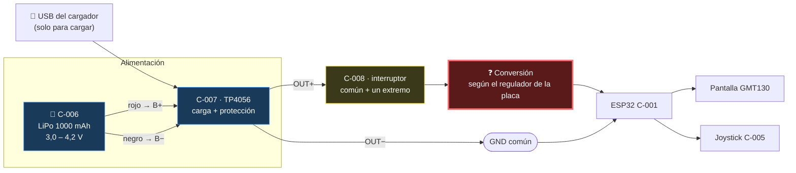

# Alimentación por batería

- **Estado:** 🟡 **Diseño — falta una pieza y falta un dato** (2026-08-30)
- **Piezas:** [C-006 batería](../3-componentes/bateria-lipo-1000mah.md) ·
  [C-007 cargador](../3-componentes/tp4056-cargador.md) ·
  [C-008 interruptor](../3-componentes/interruptor-ss12d00.md)

---

## Lo que se quiere

Que el Tamagotchi funcione **sin cable**, se cargue por USB, y se apague y
encienda con un interruptor. Hoy vive enchufado al USB del ESP32.

## ⚠️ Por qué no se puede conectar directamente

Es lo primero que hay que entender, porque la conexión "obvia" **no funciona y
puede romper la placa**.

La batería no da una tensión: da un **rango que se mueve mientras se gasta**.

```
        4,2 V ┤ recién cargada
              │
        3,7 V ┤ la mayor parte de su vida
              │
        3,3 V ┤ ......... lo que el ESP32 necesita .........
              │
        3,0 V ┤ vacía
```

Fíjate dónde cae la línea de 3,3 V: **en medio**. La batería empieza por encima y
termina por debajo. Los dos caminos directos fallan, cada uno a su manera:

| Conexión | Qué pasa | Gravedad |
|---|---|---|
| `OUT+` → pin **`3V3`** | 4,2 V en un pin que aguanta **3,6 V máximo** | 💀 **Rompe el ESP32** |
| `OUT+` → pin **`VIN`** | El regulador de la placa necesita más tensión de la que hay | ⚠️ Arranca y se reinicia solo |

El segundo merece explicación porque es el que engaña. El pin `VIN` no alimenta
al chip: entra a un **regulador** de la placa que baja a 3,3 V. Y un regulador
necesita un margen por encima de lo que entrega —lo que "se queda" para
funcionar—. Si el habitual `AMS1117` está montado, ese margen es de **1,1 V**:
necesitaría 4,4 V de entrada y la batería nunca los tiene.

Síntoma: funciona un rato con la batería llena, y al bajar a 3,7 V el aparato
**se reinicia solo**. Que es exactamente el fallo que ya está avisado en
`CLAUDE.md` — *"si la fuente no lo aguanta, la placa se reinicia sola y parece un
bug de software"*.

🔑 **Un regulador no puede subir tensión, solo bajarla — y ni siquiera hasta el
borde.** Siempre se queda con un peaje.

## 🔎 El dato que falta, y puede ahorrarte una compra

Existe un caso en el que **sí funcionaría sin comprar nada**: que tu placa no
lleve un `AMS1117` sino un regulador **de bajo margen** (`ME6211`, `SGM2212`,
`XC6206`…), que solo se queda **0,1–0,25 V**. Con uno de esos, alimentar por
`VIN` funcionaría desde 4,2 V hasta ~3,5 V — casi toda la batería.

Las placas ESP32 con **USB-C**, como la C-001, montan a menudo uno de estos.

> **Hay que mirarlo.** Es un chip diminuto de 3 patas, cerca del conector USB o
> del pin `3V3`, con dos o tres letras encima. Con una foto de cerca se lee.

De la respuesta salen dos caminos:

| Lo que ponga | Qué significa | Qué hace falta |
|---|---|---|
| `AMS1117` / `1117` | Margen de 1,1 V | ⚠️ **Un elevador a 5 V** |
| `ME6211` / `6211` / `SGM2212` / `662K` | Margen de 0,2 V | ✅ **Nada: `OUT+` a `VIN` y listo** |

## El esquema

La pieza en rojo es la que todavía no está decidida.



### El interruptor: dónde va y por qué ahí

Va en la línea **`OUT+`**, entre el cargador y el resto. **No** entre la batería
y el cargador.

La razón es práctica: así **apagar el aparato no impide cargarlo**. Si el
interruptor cortara antes del cargador, tendrías que dejarlo encendido para que
cargase.

```
  TP4056 OUT+ ──── pata del MEDIO (común, ya tiene el cable rojo)
                        │
                   [interruptor]
                        │
                   pata de un EXTREMO ──── hacia el convertidor
                        
                   la otra pata del extremo: al aire, no se usa
```

⚠️ **Cuál de los dos extremos elijas decide hacia qué lado enciende.** Si al
montarlo queda al revés, se pasa el cable a la otra pata — no hay que rehacer
nada más.

⚠️ **La corriente va justa:** estos interruptores son de ~0,5 A y el ESP32 pica a
500 mA. Si el convertidor que se compre tiene pin **`EN`**, es mejor que el
interruptor gobierne ese pin en vez de llevar la corriente. Está explicado en
[su ficha](../3-componentes/interruptor-ss12d00.md).

## Orden de montaje

⚠️ **Un paso a la vez, y midiendo entre paso y paso.** Aquí hay una batería que
no se puede apagar: montarlo todo y probar deja varios sospechosos y una LiPo
suelta.

1. **Antes de tocar nada:** desconecta el USB del ESP32.
2. Suelda el segundo cable del interruptor a **una pata de un extremo**.
3. **Mide con el polímetro** entre los dos cables del interruptor: debe haber
   continuidad en una posición y ninguna en la otra. *Todavía sin batería.*
4. Suelda `OUT+` del cargador al cable de la **pata del medio**.
5. **Mide `OUT+` contra `OUT-`** con el interruptor encendido: debe salir la
   tensión de la batería (entre 3,0 y 4,2 V). ⚠️ **Con el interruptor apagado
   debe dar 0 V.** Si no da 0, algo está mal cableado: para y revisa.
6. Solo entonces, conectar el convertidor y por último el ESP32.

⚠️ **En ningún momento juntes el cable de `OUT+` con el de `OUT-`.** Es un
cortocircuito de la batería.

## Lo que queda por decidir

- 🔲 **Leer el regulador de la placa C-001.** De ahí sale si hace falta comprar
  algo o no.
- 🔲 Si hace falta: elegir entre elevar a 5 V (más simple, se aprovecha el
  regulador que ya hay) o convertir a 3,3 V directo (más eficiente, más
  autonomía). Merece su propio ADR, que la metodología pide expresamente para el
  esquema de alimentación.
- 🔲 **Medir la autonomía real.** La estimación de 4–6 h es un cálculo, no una
  medida.
- 🔲 La protoboard no aguanta un aparato que se lleva de un sitio a otro. Ya
  estaba anotado en la bitácora y con batería pesa más.
