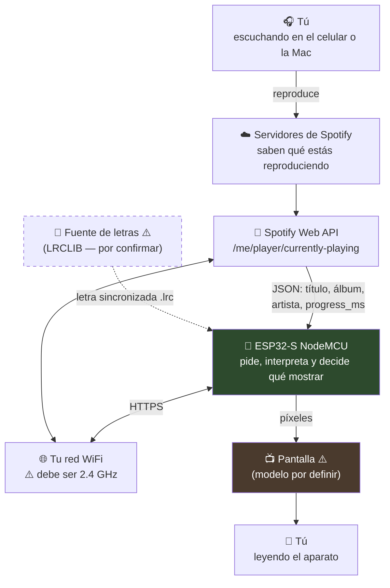
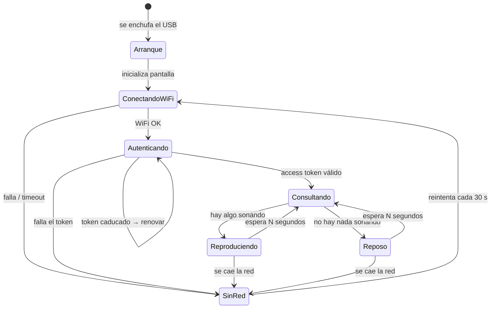

# Arquitectura end-to-end — Tamagotchi Spotify

> **Estado:** Borrador. Las partes marcadas con ⚠️ dependen de decisiones aún
> abiertas ([ADR-0002](../1-decisiones/ADR-0002-como-obtener-datos-de-spotify.md),
> [ADR-0003](../1-decisiones/ADR-0003-fuente-de-las-letras.md)).

Este documento mapea el proyecto completo en dos planos: **el lógico** (por dónde
viaja la información) y **el físico** (qué cable va a qué pin).

---

## 1. Plano lógico — el viaje del dato

De dónde sale "la canción que estás escuchando" hasta que aparece frente a tus ojos.

**Lo que hay que entender de este diagrama:**

El ESP32 **no se entera solo** de que cambiaste de canción. Nadie le avisa. Lo
que hace es **preguntar cada cierto tiempo** ("¿qué está sonando ahora?"), comparar
con lo que tenía, y redibujar si cambió. A eso se le llama *polling*.

Por eso el requerimiento RF-01 dice "en menos de 10 segundos" y no
"instantáneamente": el retraso máximo es el intervalo entre preguntas. Preguntar
más seguido lo hace más reactivo, pero consume más batería y se acerca al límite
de peticiones que impone Spotify. Es un balance, y es una decisión de diseño real.

---

## 2. Ciclo de vida del firmware

Qué hace el ESP32 desde que lo enchufas.

**Por qué importan los estados feos:** `SinRed` y `Reposo` son los que separan un
proyecto de tutorial de uno que de verdad puedes dejar prendido.

Piénsalo: si el WiFi se cae y el código no lo contempla, el aparato se queda
mostrando la última canción para siempre. Tú lo miras, ves un título, y asumes que
está sonando. **Está mintiéndote.** De ahí sale el RF-07: hay que poder distinguir
"no hay música" de "no hay internet".

Y el estado `Autenticando → Autenticando` es la renovación del token de Spotify,
que caduca cada hora. Sin eso, el aparato funciona una hora y luego se muere en
silencio. Ese es el tipo de detalle que decide si el RNF-06 (una semana prendido)
se cumple o no.

---

## 3. Plano físico — conexiones

⚠️ **Pendiente.** No se puede dibujar hasta saber qué pantalla se va a usar
(futuro ADR-0004) y confirmar el modelo exacto del ESP32.

Cuando esté definido, aquí va:

- Diagrama de conexiones (qué cable va de dónde a dónde)
- **Tabla de asignación de pines** — el documento que consultas antes de tocar un
  cable
- Cómo se alimenta cada componente y cuánta corriente consume el conjunto

### Tabla de pines *(plantilla vacía)*

| Pin ESP32 | Va a | Función | Notas / precauciones |
|---|---|---|---|
| 3V3 | | Alimentación 3.3 V | ⚠️ Nunca conectar aquí algo que necesite 5 V |
| GND | | Tierra común | Todo comparte tierra. Es la conexión que más se olvida |
| | | | |

> **Sobre los pines "especiales" del ESP32:** no todos los pines sirven para
> cualquier cosa. Algunos tienen que estar en cierto nivel al arrancar o la placa
> no enciende; otros son solo de entrada y no pueden encender un LED. Es una
> fuente clásica de horas perdidas. Cuando definamos la pantalla, documento en la
> ficha del ESP32 exactamente cuáles evitar y por qué.

---

## 4. Dependencias externas y sus riesgos

Todo lo que este proyecto necesita de terceros — es decir, todo lo que puede
romperse sin que tú hayas tocado nada:

| Depende de | Para qué | Si falla… | Riesgo |
|---|---|---|---|
| Spotify Web API | RF-01, RF-02, RF-03 | El proyecto pierde su razón de ser | 🔴 Alto |
| Fuente de letras ⚠️ | RF-04 | Se cae solo la función de letras | 🟡 Medio |
| WiFi 2.4 GHz de casa | RF-05 | No arranca nada | 🟡 Medio |
| Certificados raíz TLS | Toda la conexión HTTPS | Deja de funcionar solo, un día, sin aviso | 🟡 Medio |
| Librerías de PlatformIO | Compilación | Fijadas por versión → riesgo bajo | 🟢 Bajo |

Esa fila de los certificados es la más traicionera: es la única de la lista donde
el aparato funciona meses y **deja de funcionar sin que nadie haya cambiado
nada**. Vale la pena tenerla anotada ahora, porque el día que pase no te vas a
acordar.
