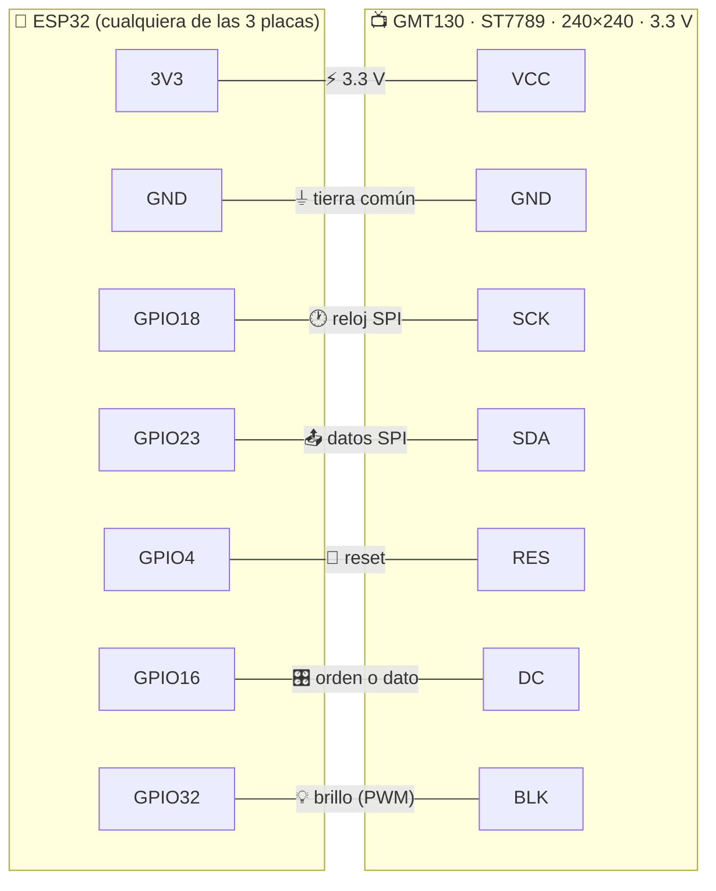

# Plano físico — conexiones ESP32 ↔ GMT130

- **Estado:** ✅ Definido — pendiente de armar
- **Fecha:** 2026-08-29
- **Basado en:** [ADR-0004](../1-decisiones/ADR-0004-pantalla-gmt130.md) · [ficha de la GMT130](../3-componentes/gmt130-tft-ips-240x240.md)

> ⚠️ **No armes esto todavía.** Primero hay que lograr que el ESP32 sea
> detectado y que corra un "Blink". Un componente a la vez.

---

## Diagrama

## 🔎 Antes de nada: cómo se llaman los pines en tu placa

La serigrafía del ESP32 **no dice "GPIO"**. Dice `P18`, `D18`, `G18` o `IO18`
según el fabricante. **Todas significan GPIO18.**

Los cinco que hay que localizar: **P18 · P23 · P4 · P16 · P32**, más `3V3` y `GND`.

⚠️ `VIN` (5 V) suele estar pegado a `3V3`. Confundirlos puede dañar la pantalla.
Tabla completa de etiquetas y trampas en la
[ficha del ESP32](../3-componentes/esp32-d0wd-v3.md#cómo-leer-las-etiquetas-de-la-placa).

## Tabla de conexiones

| # | Pin GMT130 | Pin ESP32 | Qué hace | Color de cable sugerido |
|---|---|---|---|---|
| 1 | `GND` | `GND` | Tierra común | ⚫ Negro |
| 2 | `VCC` | `3V3` | Alimentación 3.3 V | 🔴 Rojo |
| 3 | `SCK` | `GPIO18` | Reloj: marca el ritmo de los bits | 🟡 Amarillo |
| 4 | `SDA` | `GPIO23` | Datos: por aquí viajan los píxeles | 🟢 Verde |
| 5 | `RES` | `GPIO4` | Reset de la pantalla | 🔵 Azul |
| 6 | `DC` | `GPIO16` | ¿Lo que llega es una orden o un dato? | 🟣 Morado |
| 7 | `BLK` | `GPIO32` | Luz de atrás, con brillo regulable | ⚪ Blanco |

Lo de los colores no es capricho: **rojo = 3.3 V y negro = tierra** es la
convención universal. Respetarla hace que un error salte a la vista de inmediato,
que es exactamente cuando quieres verlo.

---

## Por qué estos pines y no otros

El ESP32 tiene ~30 pines, pero **no todos sirven para cualquier cosa**. Estos
son los que hay que evitar, y la razón:

| Pines | Por qué evitarlos |
|---|---|
| `GPIO6`–`GPIO11` | Van conectados a la memoria flash interna. Usarlos hace que la placa **no arranque** |
| `GPIO0, 2, 5, 12, 15` | Son *strapping pins*: el ESP32 los lee al encender para decidir cómo arrancar. Si un periférico los pone en el nivel equivocado en ese instante, **la placa no bootea** — y el síntoma es intermitente y desesperante |
| `GPIO34`–`GPIO39` | Son **solo de entrada**. No pueden controlar nada, solo leer |

Los 5 pines de datos elegidos (18, 23, 4, 16, 32) esquivan las tres trampas.
Además:

- **`GPIO18` y `GPIO23`** son el reloj y los datos del **hardware SPI** del ESP32
  (bus VSPI). Usar el hardware en vez de simular SPI por software es lo que hace
  que la pantalla se refresque rápido.
- **`GPIO32` para el backlight** porque soporta **PWM**. PWM significa prender y
  apagar la luz miles de veces por segundo: si está prendida el 20% del tiempo, se
  ve al 20% de brillo. Así es como se atiende el
  [RNF-02](../4-requerimientos/REQUERIMIENTOS.md#requerimientos-no-funcionales)
  (que no moleste de noche) — sin hardware extra, solo software.

Todos existen igual en el DEVKIT v1 y en el NodeMCU-32S, así que esta tabla vale
para cualquiera de tus 3 placas.

---

## Consumo estimado

| Componente | Típico | Pico |
|---|---|---|
| ESP32 (WiFi activo) | ~80–160 mA | **~500 mA** |
| GMT130 (backlight al 100%) | ~20–40 mA | ~40 mA |
| **Total** | **~120–200 mA** | **~540 mA** |

Un puerto USB entrega 500 mA como mínimo, así que alcanza. Pero está **justo en
el límite** en el pico.

⚠️ Si el aparato empieza a **reiniciarse solo** justo cuando se conecta al WiFi,
casi seguro es esto y no un bug del código: la fuente no aguanta el jalón de
corriente. Se resuelve con un cable más corto y grueso, un puerto mejor, o
bajando el brillo del backlight.

---

## Orden para armarlo

1. **Desconecta el USB del ESP32.** Siempre, antes de mover cualquier cable.
2. Conecta primero **`GND`**. Sin tierra común las señales no tienen referencia.
3. Después **`VCC` al pin `3V3`**. ⚠️ Nunca a `VIN` ni a `5V`.
4. Los 5 cables de datos.
5. **Revisa `VCC` y `GND` dos veces.** Es el par que quema cosas.
6. Ahora sí, conecta el USB.

**Primera señal de vida:** el backlight debe encender — la pantalla se ve
grisácea o blanquecina, aunque no haya nada dibujado. Si eso pasa, la
alimentación está bien y cualquier problema restante está en los datos. Ya es
medio diagnóstico hecho.
