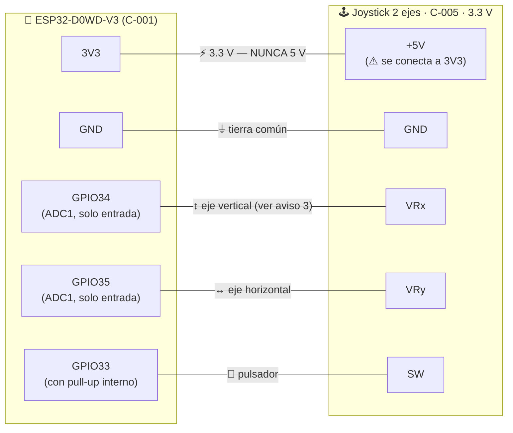

# Plano físico — ESP32 ↔ joystick analógico (C-005)

- **Estado:** ✅ **Armado y verificado** el 2026-08-29
- **Fecha:** 2026-08-29
- **Componente:** [C-005](../../../inventario/INVENTARIO.md) · módulo tipo KY-023
- **Convive con:** [`conexiones-fisicas.md`](conexiones-fisicas.md) (la pantalla)

---

## ⚠️ Los dos avisos, antes del diagrama

### 1. El pin dice `+5V` y **hay que ignorarlo**

> ⚠️ **Alimenta el joystick a `3V3`, nunca a `5V` ni a `VIN`.**
>
> Los pines del ESP32 son de 3,3 V y **no toleran 5 V**. Es lo que más placas
> mata. Si alimentas el joystick a 5 V, sus salidas `VRx` y `VRy` entregarán
> hasta 5 V directos a las entradas del ESP32.

Y no pierdes nada haciéndolo. Un joystick de estos es **un par de
potenciómetros**: un carril de resistencia con un cursor que se desliza. Da como
salida una fracción de lo que le entra.

> **La analogía:** es un divisor de una tarta. Alimentado a 5 V reparte entre 0 y
> 5 V; a 3,3 V reparte entre 0 y 3,3 V. **El centro sigue siendo el centro y los
> extremos siguen siendo los extremos.** Solo cambia el tamaño de la tarta.

Como al ESP32 solo le importa la *proporción*, no el voltaje absoluto, el
comportamiento es idéntico.

### 3. ⚠️ Los rótulos `VRx` y `VRy` **no significan horizontal y vertical**

Esto no se descubrió leyendo: se descubrió probando, y después de un rato
buscando el fallo en el sitio equivocado.

Los rótulos se refieren a los ejes **del módulo**, que dependen de cómo quede
orientado al montarlo. En este montaje, comprobado gesto a gesto el 2026-08-29:

| Empujas | Se mueve | Signo |
|---|---|---|
| **Arriba** | `VRx` → `GPIO34` | positivo |
| **Derecha** | `VRy` → `GPIO35` | positivo |

O sea que **están cruzados** respecto a lo que sugiere el nombre. Los signos, en
cambio, salieron naturales.

El síntoma es desconcertante: empujas a la derecha para saltar de canción y no
pasa nada, porque el firmware lo lee como "arriba". Todo funciona y aun así el
aparato parece ignorarte.

Por eso el código nombra los pines por su **función** (`PIN_EJE_HORIZONTAL`,
`PIN_EJE_VERTICAL`) y no por el rótulo del fabricante.

🔑 **El rótulo de un componente describe el componente, no tu montaje.** En
cuanto lo giras deja de coincidir, y el código que se fía del rótulo hereda una
mentira.

> **Si algún día se remonta girado**, se vuelve a derivar en un minuto: empujar
> en una dirección y ver qué eje se mueve y con qué signo. Luego se intercambian
> las dos constantes de [`firmware/src/joystick.h`](../firmware/src/joystick.h).

### 2. 🔑 Con WiFi encendido, **medio ESP32 no puede leer valores analógicos**

Esta es la trampa que no está en ningún rótulo y arruina proyectos enteros.

El ESP32 tiene dos conversores analógico-digital, **ADC1** y **ADC2**. El driver
de WiFi **se apropia del ADC2** mientras la radio está encendida. Si intentas
leer un pin del ADC2 con el WiFi conectado, la lectura falla o devuelve basura.

Y este aparato **tiene el WiFi encendido siempre**. O sea:

> **Los ejes del joystick TIENEN que ir a pines del ADC1.** Sin excepción.
>
> ADC1 son: `GPIO32`, `33`, `34`, `35`, `36`, `39`. Cualquier otro pin analógico
> pertenece al ADC2 y aquí **no sirve**.

El síntoma si te equivocas es de los peores: el joystick funcionaría perfecto en
una prueba suelta y dejaría de funcionar al añadir el WiFi. Buscarías el fallo en
el código de la palanca, y estaría en la radio.

---

## Diagrama

## Tabla de conexiones

| # | Pin joystick | Pin ESP32 | Qué hace | Color sugerido |
|---|---|---|---|---|
| 1 | `GND` | `GND` | Tierra común | ⚫ Negro |
| 2 | `+5V` | **`3V3`** ⚠️ | Alimentación — **jamás a 5 V ni a VIN** | 🔴 Rojo |
| 3 | `VRx` | `GPIO34` | Eje **vertical** ↕ → cambiar de modo | 🟠 Naranja |
| 4 | `VRy` | `GPIO35` | Eje **horizontal** ↔ → atrasar / adelantar | 🟡 Amarillo |
| 5 | `SW` | `GPIO33` | Pulsar la palanca → pausa / seleccionar | 🟢 Verde |

⚠️ **Ojo con el rojo.** En la pantalla, el cable rojo va a `3V3`. Aquí también.
Si algún día ves un cable rojo saliendo de `VIN` o de `5V` en este montaje, está
mal puesto.

---

## Por qué estos tres pines

| Pin | Por qué |
|---|---|
| **`GPIO34`** y **`GPIO35`** | Son del **ADC1** (obligatorio, ver aviso 2) y son **solo de entrada**. Esa limitación, que los descartó para la pantalla, aquí es justo lo que hace falta: de un joystick solo se lee. ⚠️ Cuál de los dos es horizontal depende del montaje: ver aviso 3 |
| **`GPIO33`** | El pulsador necesita una **resistencia de pull-up**, y `GPIO34`–`GPIO39` **no la tienen**. `GPIO33` sí, y es del ADC1 igualmente |

🔑 Hay una simetría bonita: `GPIO34` y `GPIO35` estaban en la lista de *"pines a
evitar"* del [plano de la pantalla](conexiones-fisicas.md#por-qué-estos-pines-y-no-otros)
precisamente por ser solo de entrada. **Una limitación no es un defecto: depende
de para qué.** Para leer una palanca son los mejores pines de la placa, porque no
hacen falta para nada más.

### Qué es un *pull-up*, y por qué el pulsador lo necesita

Un pulsador solo sabe hacer una cosa: **cerrar un camino a tierra** cuando lo
aprietas. Cuando no lo aprietas, no conecta con nada — y un pin del ESP32 sin
conectar a nada no lee "0", lee **ruido**: capta interferencias del ambiente y
cambia de valor solo.

> **La analogía:** es como preguntarle algo a alguien que puede o no responder.
> Si no dice nada, no sabes si es un "no" o si no te oyó. El pull-up es acordar
> de antemano que **el silencio significa "no"**.

Una resistencia de *pull-up* sube el pin a 3,3 V de forma suave y permanente. Al
apretar el botón, éste lo tira a `GND` con mucha más fuerza y gana. Así:

- **Sin pulsar** → el pin lee `1` (alto), por el pull-up
- **Pulsado** → el pin lee `0` (bajo), porque va a tierra

⚠️ Fíjate en que **está invertido** respecto a la intuición: pulsado es `0`. En el
código se activa con `pinMode(PIN_SW, INPUT_PULLUP)`, y no hace falta soldar
ninguna resistencia — el ESP32 lleva una dentro.

---

## Cómo queda el mapa de pines completo

| GPIO | Ocupado por | Desde |
|---|---|---|
| `GPIO4` | GMT130 · `RES` | pantalla |
| `GPIO16` | GMT130 · `DC` | pantalla |
| `GPIO18` | GMT130 · `SCK` | pantalla |
| `GPIO23` | GMT130 · `SDA` | pantalla |
| `GPIO32` | GMT130 · `BLK` (brillo PWM) | pantalla |
| **`GPIO33`** | **Joystick · `SW`** | **nuevo** |
| **`GPIO34`** | **Joystick · `VRx` = eje vertical** ↕ | **nuevo** |
| **`GPIO35`** | **Joystick · `VRy` = eje horizontal** ↔ | **nuevo** |

Sin conflictos. Y quedan libres `GPIO36` y `GPIO39` del ADC1 por si algún día
hace falta otra entrada analógica.

---

## Consumo — no cambia nada

Un joystick en reposo consume lo que dejan pasar sus dos potenciómetros de 10 kΩ
a 3,3 V: **unos 0,33 mA**. Frente a los ~500 mA de pico del ESP32 transmitiendo,
es despreciable. No hay que revisar la alimentación.

---

## Orden para armarlo — una cosa a la vez

⚠️ **Desconecta el USB del ESP32 antes de tocar ningún cable.**

1. **`GND` primero.** Sin tierra común, las señales no tienen referencia y las
   lecturas serían un sinsentido.
2. **`+5V` del joystick → `3V3` del ESP32.** Revísalo dos veces. Es el cable que
   puede quemar la placa.
3. `VRx` → `GPIO34`.
4. `VRy` → `GPIO35`.
5. `SW` → `GPIO33`.
6. **Revisa otra vez alimentación y tierra** antes de enchufar nada.
7. Ahora sí, conecta el USB.

### Primera comprobación, antes de escribir una línea de firmware definitivo

Un programa mínimo que imprima los dos ejes y el botón. Qué esperar:

| Situación | `VRx` / `VRy` | `SW` |
|---|---|---|
| Palanca en reposo (centro) | Ambos cerca de **la mitad del rango** (~1900 de 4095) | `1` |
| Palanca a tope en cada dirección | Cerca de `0` en un extremo y de `4095` en el otro | `1` |
| Palanca pulsada hacia abajo | Sin cambio | `0` |

⚠️ **Los valores en reposo casi nunca son exactamente el centro.** Estos módulos
son baratos y cada unidad tiene su desviación. Por eso el firmware deberá **medir
el reposo al arrancar** y guardarlo como referencia, en vez de dar por hecho que
son 2048. Sin eso, el aparato creería que estás moviendo la palanca cuando no la
tocas.

Y hará falta una **zona muerta**: un margen alrededor del centro donde no se hace
nada. Si no, el ruido eléctrico del propio conversor haría saltar canciones solo.
