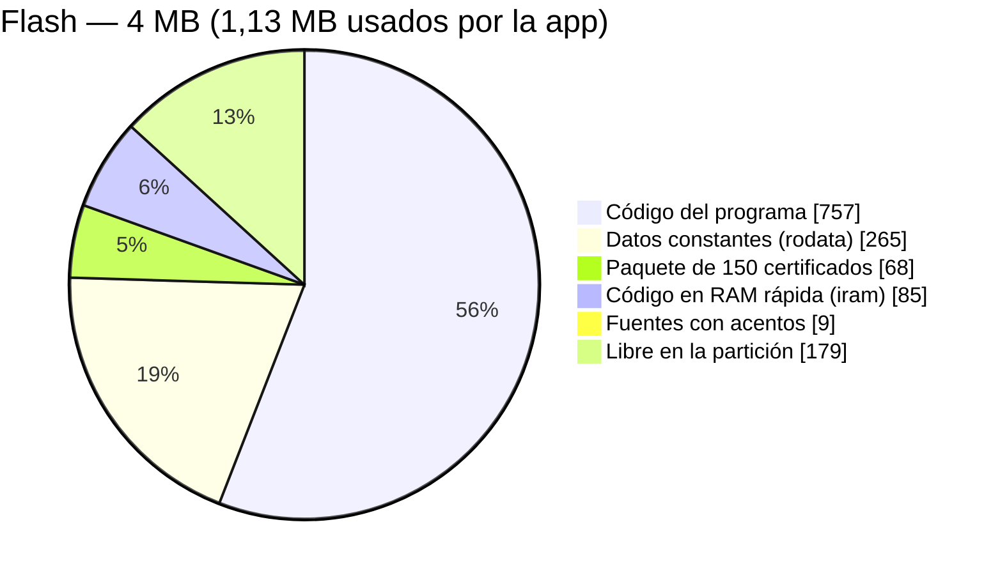
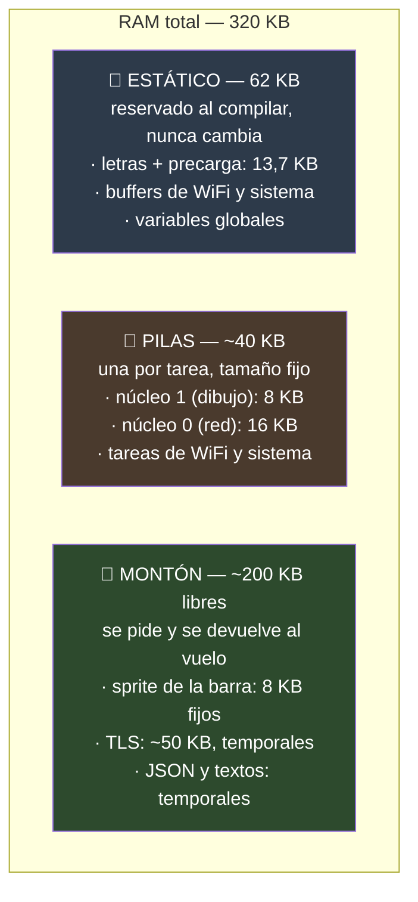
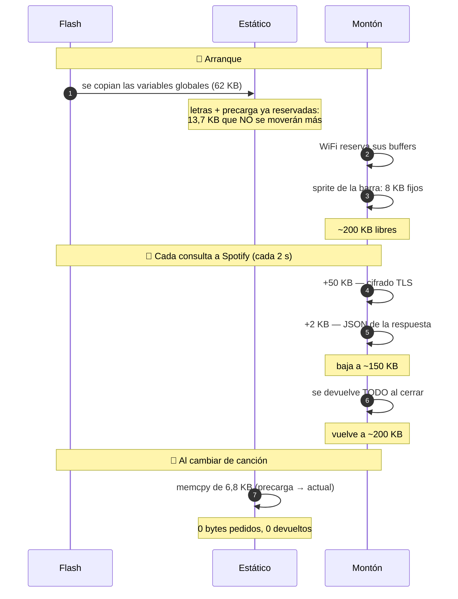

# Mapa de memoria — dónde vive cada cosa

- **Fecha:** 2026-08-29
- **Medido sobre:** el firmware completo (dos núcleos, letras, precarga, sprite)

---

## Lo primero: son dos memorias distintas

Es el error conceptual más común al empezar. El ESP32 tiene **dos** memorias que
no se parecen en nada:

|  | **Flash** | **RAM** |
|---|---|---|
| Tamaño | **4 MB** | **320 KB** |
| ¿Se borra al apagar? | ❌ No, es permanente | ✅ Sí, se pierde |
| Qué guarda | El programa, las fuentes, los certificados | Los datos mientras funciona |
| Velocidad | Lenta | Rápida |
| Analogía | El disco duro | La memoria de trabajo |

Cuando `platformio` dice **`Flash: 86.3%`** y **`RAM: 18.9%`**, habla de estas dos
cosas por separado. Y ese `RAM: 18.9%` **no es toda la RAM que se usa** — es solo
la que queda reservada al compilar. El resto se pide y devuelve mientras el
programa corre.

---

## La Flash: 4 MB, casi llena de programa



Lo que vive aquí **no gasta RAM**:

| Qué | Tamaño | Por qué está en flash |
|---|---|---|
| Certificados raíz (150 CAs) | 68 KB | Solo se lee el que hace falta, cuando hace falta |
| Fuentes con acentos | 8,8 KB | Los dibujos de las letras nunca cambian |
| Código del programa | 757 KB | Obvio |

🔑 **Que algo ocupe mucho no significa que sea caro.** El paquete de certificados
son 68 KB de flash y **cero** de RAM. Es lo que hizo viable elegir los 150
certificados en vez de uno solo ([ADR-0009](../1-decisiones/ADR-0009-certificados-raiz.md)).

---

## La RAM: 320 KB, y aquí está toda la acción



### Las tres zonas, y por qué importa la diferencia

**📌 Estático** — se decide al compilar y no cambia jamás. Aquí viven las letras.

**🧵 Pilas** — cada tarea tiene la suya, de tamaño **fijo**. Aquí viven las
variables locales de las funciones.

> ⚠️ Esta zona ya nos costó un reinicio. Un objeto de letras (6,8 KB) declarado
> como variable local casi llenaba él solo la pila de 8 KB → `Stack canary
> watchpoint triggered`. Y lo desconcertante era que **había 186 KB libres** —
> pero de montón, que es otro sitio.
>
> 🔑 **`ESP.getFreeHeap()` no dice nada sobre la pila.**

**🔄 Montón** — se pide y se devuelve sobre la marcha. Aquí van los textos, el
JSON y los buffers de cifrado.

---

## Qué pasa desde que lo enchufas



---

## Cómo se manejan las letras (y por qué así)

**Respuesta corta: no se libera nada, porque no se reserva nada.**

```cpp
struct LineaLetra {
  long ms;              //  4 bytes
  char texto[72];       // 72 bytes
};                      // 76 bytes por línea

struct Letras {
  LineaLetra lineas[90];   // 6.840 bytes — reservado de una vez
  int n;                   // cuántas líneas se están usando
};
```

Hay **dos** de estos, y son variables globales:

| | Tamaño | Para qué |
|---|---|---|
| `letras` | 6.840 B | La canción que suena |
| `precarga` | 6.840 B | La siguiente, descargada por adelantado |
| **Total** | **13.680 B** | Reservados al arrancar, para siempre |

### Las tres operaciones

| Operación | Qué hace de verdad | Coste |
|---|---|---|
| `limpiar()` | `n = 0` | **1 instrucción.** Nada que liberar |
| `letras = precarga` | Copia 6,8 KB de un sitio a otro | Microsegundos |
| Cargar una letra nueva | Escribe encima de lo anterior | 0 bytes pedidos |

**Nunca se llama a `new` ni a `delete`.** La memoria se reserva una vez al
arrancar y se reutiliza el resto de la vida del aparato.

### Por qué se hizo así

La alternativa natural sería pedir memoria por cada canción y devolverla al
cambiar. Funciona… un rato.

```
Pedir y devolver miles de veces:

  [texto][hueco][texto][hueco][texto][hueco]
         ↑              ↑            ↑
   la memoria queda picada: hay 100 KB libres,
   pero ninguno seguido donde quepa algo grande
```

Eso es la **fragmentación**, y es especialmente traicionera en un aparato que va
a estar encendido días: falla **cuando lleva mucho tiempo funcionando**, que es
justo cuando no lo estás mirando.

Con un tamaño fijo **eso no puede pasar**. A cambio se gastan 13,7 KB aunque la
canción tenga 3 líneas.

🔑 **En sistemas que deben funcionar meses sin reiniciarse, se prefiere reservar
de más una vez antes que pedir y devolver muchas veces.** Se cambia eficiencia
por previsibilidad, y la previsibilidad vale más.

### Los límites que impone

| Límite | Valor | Qué pasa al pasarse |
|---|---|---|
| Líneas por canción | 90 | Las de más se ignoran |
| Caracteres por línea | 71 | Se recorta |

Suficiente: las canciones medidas rondan las 18–58 líneas.

---

## Números medidos

De 11 muestras durante 5,5 minutos con todo funcionando:

| | Valor |
|---|---|
| Libre en reposo | **~201 KB** |
| Libre descargando una letra | ~151 KB |
| **Mínimo histórico** | **63,6 KB** |
| Bloque contiguo mayor (reposo) | **110.580 B — siempre el mismo** |

Ese último número es el que descarta la fragmentación: baja durante las
descargas y **vuelve exactamente al mismo valor**. Si hubiera fragmentación real,
bajaría y no volvería a subir.

🔑 **Un valor que sube y baja no es una fuga: es uso normal. Lo que hay que
vigilar es que vuelva al mismo sitio.**

El mínimo de 63,6 KB es el peor instante posible: los dos núcleos trabajando a la
vez, con cifrado activo. Bajó desde los 97 KB anteriores porque ahora red y
dibujo **coinciden en el tiempo** en vez de turnarse — que es exactamente lo que
se buscaba al repartirlos.

---

## Resumen en una tabla

| Cosa | Dónde vive | Tamaño | ¿Se libera? |
|---|---|---|---|
| Código del programa | Flash | 757 KB | Nunca |
| 150 certificados raíz | Flash | 68 KB | Nunca (cero RAM) |
| Fuentes con acentos | Flash | 8,8 KB | Nunca (cero RAM) |
| **Letras (×2)** | **Estático** | **13,7 KB** | **Nunca — se reutilizan** |
| Pila del núcleo de dibujo | Pila | 8 KB | Nunca |
| Pila del núcleo de red | Pila | 16 KB | Nunca |
| Sprite de la barra | Montón | 8 KB | Nunca (se crea al arrancar) |
| Cifrado TLS | Montón | ~50 KB | ✅ En cada consulta |
| JSON, textos | Montón | variable | ✅ Al salir de cada función |
