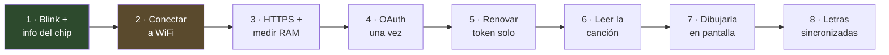
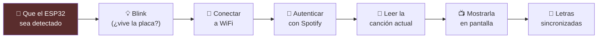

# 🐣 Tamagotchi Spotify

Un aparatito de escritorio con ESP32 que muestra qué estás escuchando en Spotify
—canción, álbum, artista— y más adelante, la letra sincronizada.

> **Por qué se llama Tamagotchi:** por dónde queremos llegar (una mascota virtual
> que reacciona a tu música), no por lo que hace hoy. La v1 es "una pantalla que
> muestra la canción", que ya trae bastante trabajo.

- **Estado:** 🟢 Placa funcionando · siguiente paso: conectar a WiFi
- **Tipo:** Proyecto de descubrimiento (se compran piezas sobre la marcha)
- **Objetivo real:** aprender electrónica e IoT

---

## 📍 Dónde vamos



✅ **Paso 1 hecho.** La cadena completa funciona: editar → compilar → cargar →
ejecutar → leer.

```
Chip:      ESP32-D0WD-V3, 2 núcleos @ 240 MHz, 4 MB flash
RAM libre: 303.5 KB          ← la línea base a vigilar
Red:       INFINITUMEB00, canal 11, −39 dBm (excelente)
```

### 🔜 Siguiente: paso 2 — conectar a WiFi

Solo falta la contraseña de la red, y **no hace falta que la escribas en el chat**:

```bash
cd proyectos/tamagotchi/firmware
cp include/secrets.h.ejemplo include/secrets.h
# abre include/secrets.h y rellena WIFI_PASSWORD
```

`secrets.h` está bloqueado por `.gitignore`, así que nunca se sube al repositorio
(RNF-05). La plantilla `.ejemplo` sí se sube: guarda la *estructura* de lo que
hace falta, nunca los valores.

**El paso 3 es el importante:** medir cuánta RAM queda con TLS activo. Es el punto
de control del [ADR-0002](1-decisiones/ADR-0002-como-obtener-datos-de-spotify.md)
y el riesgo #1 del proyecto. Si el número no alcanza, hay que replantear la
arquitectura — y por eso se mide **antes** de escribir la lógica de Spotify.

## Cómo está organizado

Las carpetas siguen las 6 fases de la
[metodología del taller](../../metodologia/README.md):

| Carpeta | Qué contiene | Estado |
|---|---|---|
| [`1-decisiones/`](1-decisiones/) | ADRs: por qué hicimos lo que hicimos | 🟢 4 escritos · solo el 0003 sigue abierto |
| [`2-entorno/`](2-entorno/) | El entorno aislado y cómo levantarlo | 🟢 PlatformIO 6.1.19 + esptool 5.3.1 instalados |
| [`3-componentes/`](3-componentes/) | Ficha de cada pieza | 🟢 ESP32 y GMT130 confirmados |
| [`4-requerimientos/`](4-requerimientos/) | Qué tiene que hacer el aparato | 🟢 Borrador listo |
| [`5-investigacion/`](5-investigacion/) | Lo que hubo que averiguar, con fuentes | 🟢 API de Spotify verificada |
| [`6-esquemas/`](6-esquemas/) | El mapa: lógico y físico | 🟢 Los dos listos |
| `firmware/` | El código | 🟢 Prueba de vida corriendo en la placa |
| [`BITACORA.md`](BITACORA.md) | Qué pasó en cada sesión | 🟢 Al día |

---

## Por dónde va la cosa



Cada paso solo se ataca cuando el anterior funciona. Es lento a propósito: si
saltas pasos y algo falla, tienes cinco sospechosos en vez de uno.

**Y hay una tarea que se puede hacer en paralelo, sin la placa:** verificar que
la API de Spotify todavía permite leer "reproduciendo ahora" con una app personal
(supuesto S-02). Es el riesgo más grande del proyecto y no depende del hardware.

---

## Lo que hay que saber antes de empezar

Tres cosas que van a salir tarde o temprano, mejor saberlas desde ahora:

**El ESP32 solo se conecta a WiFi de 2.4 GHz.** No entiende 5 GHz. Y como muchos
routers usan el mismo nombre de red para ambas bandas, es un clásico de "no me
conecta y no sé por qué".

**Los pines del ESP32 son de 3.3 V y no toleran 5 V.** Conectar algo de 5 V a un
pin de datos es la forma más común de matar una placa. Cuando aplique, te aviso.

**Spotify no da letras por su API pública.** Las letras que ves en la app vienen
de otro proveedor y no están disponibles desde fuera. Van a tener que salir de
otra fuente. Está documentado en el
[ADR-0003](1-decisiones/ADR-0003-fuente-de-las-letras.md).

## 📦 Material disponible

| Componente | Cant. | Para qué |
|---|---|---|
| ESP32-S NodeMCU (USB-C) | 2 | El cerebro. Una de repuesto |
| ESP32 DEVKIT v1 (mini-USB) | 1 | 🎯 La placa de diagnóstico |
| TFT IPS 1.3" GMT130, 240×240 color | 4 | La pantalla ([ADR-0004](1-decisiones/ADR-0004-pantalla-gmt130.md)) |

Detalle en [`inventario/INVENTARIO.md`](../../inventario/INVENTARIO.md).

**La pantalla resultó mejor de lo esperado.** El plan asumía una OLED de 0.96"
(4 líneas de 20 caracteres). La GMT130 da del orden de 15 líneas de 30, a color.
Eso mueve las letras (RF-04) de "probablemente inviable" a "hay que probarlo".

---

## Decisiones que te toca tomar

| Qué | Dónde | Por qué depende de ti |
|---|---|---|
| ~~¿Directo o vía puente?~~ | [ADR-0002](1-decisiones/ADR-0002-como-obtener-datos-de-spotify.md) | ✅ Resuelto: **directo**, porque el objetivo es aprender |
| ~~¿Qué pantalla?~~ | [ADR-0004](1-decisiones/ADR-0004-pantalla-gmt130.md) | ✅ Resuelto: la GMT130 que ya tienes |
