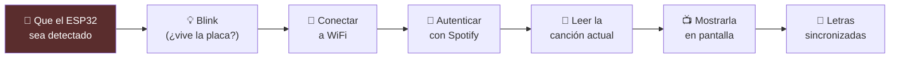

# 🐣 Tamagotchi Spotify

Un aparatito de escritorio con ESP32 que muestra qué estás escuchando en Spotify
—canción, álbum, artista— y más adelante, la letra sincronizada.

> **Por qué se llama Tamagotchi:** por dónde queremos llegar (una mascota virtual
> que reacciona a tu música), no por lo que hace hoy. La v1 es "una pantalla que
> muestra la canción", que ya trae bastante trabajo.

- **Estado:** 🔴 Bloqueado — el ESP32 no responde
- **Tipo:** Proyecto de descubrimiento (se compran piezas sobre la marcha)
- **Objetivo real:** aprender electrónica e IoT

---

## 🚧 Bloqueante actual

**Ninguna placa ESP32 aparece en la Mac.** Todo lo demás está listo, pero sin
placa no hay firmware.

### 🎯 La prueba que hay que hacer primero

**Conecta la C-003 — el ESP32 DEVKIT v1, el viejito de puerto mini-USB.**

Suena raro empezar por la placa más vieja, pero es la que más información da, y
la razón es esta:

> El estándar USB-C exige que todo aparato lleve **dos resistencias de 5.1 kΩ**
> en unas líneas llamadas CC, para poder decirle a la computadora *"aquí estoy,
> dame corriente"*. **Muchísimas placas ESP32 baratas con USB-C las omiten.** El
> fabricante probó con un cable USB-A → USB-C y le funcionó — porque un puerto
> USB-A entrega 5 V sin preguntar. Pero un puerto USB-C **no entrega nada hasta
> que el otro lado se identifica**.
>
> | Cable | Qué pasa |
> |---|---|
> | USB-A → USB-C | ✅ Funciona |
> | USB-C → USB-C | ❌ **Nada. Ni corriente, ni detección** |
>
> Tu Mac es Apple Silicon: puertos USB-C. Lo natural fue agarrar un cable C-a-C.
> Y el síntoma encaja exacto: cero dispositivos en el árbol USB, como si no
> hubiera nada conectado.

La C-003 tiene **mini-USB**, así que por fuerza usa un cable A-a-mini y **no
puede tener este problema**. Por eso es la prueba decisiva:

- ✅ **Si aparece** → hipótesis confirmada. Se arregla con un cable USB-A → USB-C,
  y además ya tienes una placa con la que empezar hoy mismo.
- ❌ **Si tampoco aparece** → el problema no son las placas: es el cable (que sea
  de solo carga) o el dock.

En los dos casos sales del bloqueo sabiendo más.

### Si no tienes cable mini-USB a la mano

Prueba estas, en orden, con las placas USB-C:

1. **Un cable USB-A → USB-C**, con la punta A en un puerto USB-A (tu dock tiene)
   o en un adaptador A-a-C.
2. **Que el cable sea de datos, no de solo carga.** Muchos cables (los de power
   banks, audífonos) llevan corriente pero no datos: la placa enciende su LED y
   la compu nunca la ve.
3. **Directo a la Mac**, no al dock DisplayLink.

Después de cada intento dime "ya" y yo corro el diagnóstico.

## Cómo está organizado

Las carpetas siguen las 6 fases de la
[metodología del taller](../../metodologia/README.md):

| Carpeta | Qué contiene | Estado |
|---|---|---|
| [`1-decisiones/`](1-decisiones/) | ADRs: por qué hicimos lo que hicimos | 🟡 4 escritos, 2 sin decidir |
| [`2-entorno/`](2-entorno/) | El entorno aislado y cómo levantarlo | 🟢 PlatformIO 6.1.19 + esptool 5.3.1 instalados |
| [`3-componentes/`](3-componentes/) | Ficha de cada pieza | 🟡 GMT130 ✅ confirmada · ESP32 pendiente |
| [`4-requerimientos/`](4-requerimientos/) | Qué tiene que hacer el aparato | 🟢 Borrador listo |
| [`5-investigacion/`](5-investigacion/) | Lo que hubo que averiguar, con fuentes | 🔴 Sin empezar |
| [`6-esquemas/`](6-esquemas/) | El mapa: lógico y físico | 🟢 Los dos listos |
| `firmware/` | El código | 🔴 Sin empezar |
| [`BITACORA.md`](BITACORA.md) | Qué pasó en cada sesión | 🟢 Al día |

---

## Por dónde va la cosa

Cada paso solo se ataca cuando el anterior funciona. Es lento a propósito: si
saltas pasos y algo falla, tienes cinco sospechosos en vez de uno.

**Y hay una tarea que se puede hacer en paralelo, sin la placa:** verificar que
la API de Spotify todavía permite leer "reproduciendo ahora" con una app personal
(supuesto S-02). Es el riesgo más grande del proyecto y no depende del hardware.

---

## Lo que hay que saber antes de empezar

Tres cosas que van a salir tarde o temprano, mejor saberlas desde ahora:

**El ESP32 solo se conecta a WiFi de 2.4 GHz.** No entiende 5 GHz. Y como muchos
routers usan el mismo nombre de red para ambas bandas, es un clásico de "no me
conecta y no sé por qué".

**Los pines del ESP32 son de 3.3 V y no toleran 5 V.** Conectar algo de 5 V a un
pin de datos es la forma más común de matar una placa. Cuando aplique, te aviso.

**Spotify no da letras por su API pública.** Las letras que ves en la app vienen
de otro proveedor y no están disponibles desde fuera. Van a tener que salir de
otra fuente. Está documentado en el
[ADR-0003](1-decisiones/ADR-0003-fuente-de-las-letras.md).

## 📦 Material disponible

| Componente | Cant. | Para qué |
|---|---|---|
| ESP32-S NodeMCU (USB-C) | 2 | El cerebro. Una de repuesto |
| ESP32 DEVKIT v1 (mini-USB) | 1 | 🎯 La placa de diagnóstico |
| TFT IPS 1.3" GMT130, 240×240 color | 4 | La pantalla ([ADR-0004](1-decisiones/ADR-0004-pantalla-gmt130.md)) |

Detalle en [`inventario/INVENTARIO.md`](../../inventario/INVENTARIO.md).

**La pantalla resultó mejor de lo esperado.** El plan asumía una OLED de 0.96"
(4 líneas de 20 caracteres). La GMT130 da del orden de 15 líneas de 30, a color.
Eso mueve las letras (RF-04) de "probablemente inviable" a "hay que probarlo".

---

## Decisiones que te toca tomar

| Qué | Dónde | Por qué depende de ti |
|---|---|---|
| ¿El ESP32 habla directo con Spotify, o vía un puente en la Mac? | [ADR-0002](1-decisiones/ADR-0002-como-obtener-datos-de-spotify.md) | Es un balance entre "aprendo más" y "avanzo más rápido" |
| ~~¿Qué pantalla?~~ | [ADR-0004](1-decisiones/ADR-0004-pantalla-gmt130.md) | ✅ Resuelto: la GMT130 que ya tienes |
