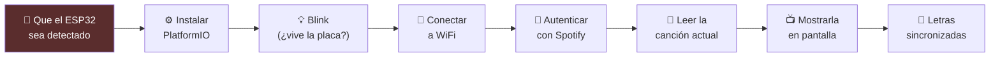

# 🐣 Tamagotchi Spotify

Un aparatito de escritorio con ESP32 que muestra qué estás escuchando en Spotify
—canción, álbum, artista— y más adelante, la letra sincronizada.

> **Por qué se llama Tamagotchi:** por dónde queremos llegar (una mascota virtual
> que reacciona a tu música), no por lo que hace hoy. La v1 es "una pantalla que
> muestra la canción", que ya trae bastante trabajo.

- **Estado:** 🔴 Bloqueado — el ESP32 no responde
- **Tipo:** Proyecto de descubrimiento (se compran piezas sobre la marcha)
- **Objetivo real:** aprender electrónica e IoT

---

## 🚧 Bloqueante actual

**La Mac no detecta el ESP32.** Todo lo demás está listo para arrancar, pero sin
la placa no se puede avanzar en firmware.

Diagnóstico completo en [`BITACORA.md`](BITACORA.md). Plan de prueba, en orden —
**haz uno, avísame, y verifico**:

1. **Confirma que la placa está enchufada** y que su LED rojo enciende.
2. **Conéctala directo a la Mac**, no al dock DisplayLink ni a un hub.
3. **⚠️ Cambia el cable USB.** Esta es la causa más probable con diferencia.
   Muchos cables micro-USB son de **solo carga** y no llevan los cables de datos.
   Usa uno que sepas que sirve para pasar archivos — por ejemplo el de un
   celular, no el de un power bank o unos audífonos.
4. Si tienes otra computadora a la mano, pruébala ahí para descartar la placa.

Después de cada intento, dime "ya" y yo corro el diagnóstico otra vez.

---

## Cómo está organizado

Las carpetas siguen las 6 fases de la
[metodología del taller](../../metodologia/README.md):

| Carpeta | Qué contiene | Estado |
|---|---|---|
| [`1-decisiones/`](1-decisiones/) | ADRs: por qué hicimos lo que hicimos | 🟡 3 escritos, 2 sin decidir |
| [`2-entorno/`](2-entorno/) | El entorno aislado y cómo levantarlo | 🟡 Documentado, sin instalar |
| [`3-componentes/`](3-componentes/) | Ficha de cada pieza | 🟡 Solo el ESP32, incompleta |
| [`4-requerimientos/`](4-requerimientos/) | Qué tiene que hacer el aparato | 🟢 Borrador listo |
| [`5-investigacion/`](5-investigacion/) | Lo que hubo que averiguar, con fuentes | 🔴 Sin empezar |
| [`6-esquemas/`](6-esquemas/) | El mapa: lógico y físico | 🟡 Lógico listo, físico pendiente |
| `firmware/` | El código | 🔴 Sin empezar |
| [`BITACORA.md`](BITACORA.md) | Qué pasó en cada sesión | 🟢 Al día |

---

## Por dónde va la cosa

Cada paso solo se ataca cuando el anterior funciona. Es lento a propósito: si
saltas pasos y algo falla, tienes cinco sospechosos en vez de uno.

**Y hay una tarea que se puede hacer en paralelo, sin la placa:** verificar que
la API de Spotify todavía permite leer "reproduciendo ahora" con una app personal
(supuesto S-02). Es el riesgo más grande del proyecto y no depende del hardware.

---

## Lo que hay que saber antes de empezar

Tres cosas que van a salir tarde o temprano, mejor saberlas desde ahora:

**El ESP32 solo se conecta a WiFi de 2.4 GHz.** No entiende 5 GHz. Y como muchos
routers usan el mismo nombre de red para ambas bandas, es un clásico de "no me
conecta y no sé por qué".

**Los pines del ESP32 son de 3.3 V y no toleran 5 V.** Conectar algo de 5 V a un
pin de datos es la forma más común de matar una placa. Cuando aplique, te aviso.

**Spotify no da letras por su API pública.** Las letras que ves en la app vienen
de otro proveedor y no están disponibles desde fuera. Van a tener que salir de
otra fuente. Está documentado en el
[ADR-0003](1-decisiones/ADR-0003-fuente-de-las-letras.md).

---

## Decisiones que te toca tomar

| Qué | Dónde | Por qué depende de ti |
|---|---|---|
| ¿El ESP32 habla directo con Spotify, o vía un puente en la Mac? | [ADR-0002](1-decisiones/ADR-0002-como-obtener-datos-de-spotify.md) | Es un balance entre "aprendo más" y "avanzo más rápido" |
| ¿Qué pantalla? | Futuro ADR-0004 | Depende de qué tengas y de cuánto texto haya que mostrar |
