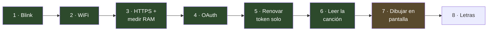

# 🐣 Tamagotchi Spotify

Un aparatito de escritorio con ESP32 que muestra qué estás escuchando en Spotify
—canción, álbum, artista— y más adelante, la letra sincronizada.

> **Por qué se llama Tamagotchi:** por dónde queremos llegar (una mascota virtual
> que reacciona a tu música), no por lo que hace hoy. La v1 es "una pantalla que
> muestra la canción", que ya trae bastante trabajo.

- **Estado:** 🟢 Leyendo Spotify · siguiente paso: la pantalla
- **Tipo:** Proyecto de descubrimiento (se compran piezas sobre la marcha)
- **Objetivo real:** aprender electrónica e IoT

---

## 📍 Dónde vamos



✅ **Pasos 1 al 6 hechos.** El ESP32 lee Spotify por su cuenta, con el
certificado del servidor verificado:

```
┌──────────────────────────────────────────────
│ 🎵  Fashion Drunk
│ 👤  Otis Stacks
│ 💿  Otis Stacks
└──────────────────────────────────────────────
  ▶ [==============      ] 2:26 / 3:26   RAM: 198 KB
```

Cada paso se atacó solo cuando el anterior funcionaba. Es lento a propósito: si
saltas pasos y algo falla, tienes seis sospechosos en vez de uno.

### 🔜 Siguiente: paso 7 — la pantalla

Es lo único que falta para cerrar RF-01, RF-02 y RF-03. **Los datos ya están**;
hay que dibujarlos.

1. Cablear la GMT130 → [`6-esquemas/conexiones-fisicas.md`](6-esquemas/conexiones-fisicas.md)
2. Decidir el ADR-0008: `TFT_eSPI` vs `Adafruit_ST7789`
3. Diseñar la pantalla: qué va grande, qué chico, qué colores

### Pendientes menores

- Prueba de resistencia de 24 h para cerrar el RNF-06 del todo
- Timeout en la sincronización NTP (hoy espera para siempre si falla)
- **S-05:** probar a mano en LRCLIB 5 canciones que escuches, para saber si las
  letras (RF-04) son viables antes de invertirles tiempo

## Cómo está organizado

Las carpetas siguen las 6 fases de la
[metodología del taller](../../metodologia/README.md):

| Carpeta | Qué contiene | Estado |
|---|---|---|
| [`1-decisiones/`](1-decisiones/) | ADRs: por qué hicimos lo que hicimos | 🟢 6 escritos · solo el 0003 sigue abierto |
| [`2-entorno/`](2-entorno/) | El entorno aislado y cómo levantarlo | 🟢 Funcionando · recompila en ~28 s |
| [`3-componentes/`](3-componentes/) | Ficha de cada pieza | 🟢 ESP32 y GMT130 confirmados |
| [`4-requerimientos/`](4-requerimientos/) | Qué tiene que hacer el aparato | 🟢 Borrador listo |
| [`5-investigacion/`](5-investigacion/) | Lo que hubo que averiguar, con fuentes | 🟢 7 hallazgos documentados |
| [`6-esquemas/`](6-esquemas/) | El mapa: lógico y físico | 🟢 Los dos listos |
| `firmware/` | El código | 🟢 Leyendo Spotify con TLS verificado |
| [`BITACORA.md`](BITACORA.md) | Qué pasó en cada sesión | 🟢 Al día |

---

## Lo que hay que saber antes de empezar

Tres cosas que van a salir tarde o temprano, mejor saberlas desde ahora:

**El ESP32 solo se conecta a WiFi de 2.4 GHz.** No entiende 5 GHz. Y como muchos
routers usan el mismo nombre de red para ambas bandas, es un clásico de "no me
conecta y no sé por qué".

**Los pines del ESP32 son de 3.3 V y no toleran 5 V.** Conectar algo de 5 V a un
pin de datos es la forma más común de matar una placa. Cuando aplique, te aviso.

**El ESP32 no confía en nadie de fábrica.** Tu Mac tiene un llavero con las
autoridades certificadoras en las que confía; el ESP32 no tiene nada. Por eso el
firmware lleva incrustado el paquete de 150 CAs de Mozilla
([ADR-0009](1-decisiones/ADR-0009-certificados-raiz.md)). Y como verificar un
certificado exige saber qué día es hoy, sincroniza la hora por NTP antes de
cualquier conexión — si no, todos los certificados le parecerían "aún no
válidos".

**Spotify no da letras por su API pública.** Las letras que ves en la app vienen
de otro proveedor y no están disponibles desde fuera. Van a tener que salir de
otra fuente. Está documentado en el
[ADR-0003](1-decisiones/ADR-0003-fuente-de-las-letras.md).

## 📦 Material disponible

| Componente | Cant. | Para qué |
|---|---|---|
| ESP32-S NodeMCU (USB-C) | 2 | El cerebro. Una de repuesto |
| ESP32 DEVKIT v1 (mini-USB) | 1 | 🎯 La placa de diagnóstico |
| TFT IPS 1.3" GMT130, 240×240 color | 4 | La pantalla ([ADR-0004](1-decisiones/ADR-0004-pantalla-gmt130.md)) |

Detalle en [`inventario/INVENTARIO.md`](../../inventario/INVENTARIO.md).

**La pantalla resultó mejor de lo esperado.** El plan asumía una OLED de 0.96"
(4 líneas de 20 caracteres). La GMT130 da del orden de 15 líneas de 30, a color.
Eso mueve las letras (RF-04) de "probablemente inviable" a "hay que probarlo".

---

## Decisiones abiertas

| Qué | Dónde | Por qué depende de ti |
|---|---|---|
| ~~¿Directo o vía puente?~~ | [ADR-0002](1-decisiones/ADR-0002-como-obtener-datos-de-spotify.md) | ✅ Resuelto: **directo**, porque el objetivo es aprender |
| ~~¿Qué pantalla?~~ | [ADR-0004](1-decisiones/ADR-0004-pantalla-gmt130.md) | ✅ Resuelto: la GMT130 que ya tienes |
| **¿`TFT_eSPI` o `Adafruit_ST7789`?** | Futuro ADR-0008 | Velocidad contra facilidad de aprendizaje. Es la siguiente |
| ¿De dónde salen las letras? | [ADR-0003](1-decisiones/ADR-0003-fuente-de-las-letras.md) | Depende de probar la cobertura de LRCLIB con tu música (S-05) |
